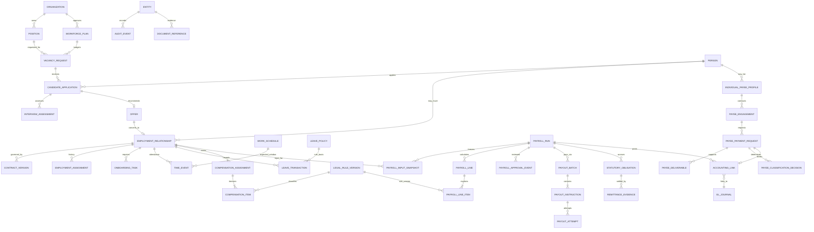

# HR / Payroll Replacement — Logical Domain Model (ERD v0.1)

**Authority:** Notion HR Design Reset v0.5. **Status:** logical ERD only. Physical table count and DDL are intentionally not frozen; live schema/data-health and complete dependency validation are still outstanding. No production schema is approved.

## Design rule

Model lifecycle facts and accounting evidence separately. Reuse proven identity, location, capability, workflow/audit, file, AP/payment and GL/PLEDGER services only after checking their source and authorization/transaction contracts. Combine logical objects into a physical table only when cardinality, privacy boundary, independent lifecycle, uniqueness, audit requirements and reporting needs justify it. Never use a generic JSON bag as a substitute for normalized, queryable, effective-dated facts.

The diagram is a domain relationship map, not executable SQL. Generic `ENTITY` means a resource in an auditable aggregate; implementation must keep resource/actor IDs and object relationships explicit.

## Logical aggregates and boundaries

| Logical aggregate | Must own | Must not own / integration boundary |
|---|---|---|
| People | Canonical natural-person identity, matching/deduplication review, privacy state | Does not itself mean employee, candidate approval or service-provider tax category |
| Employment relationship | Worker relationship, legal employer, status, contract/position/work-location effective history | Not a payroll line and not a generic person category |
| Workforce/recruitment | Budgeted plan, position, vacancy, applicant stages, interview evidence and offer | Final decisions remain human/authorized; avoid unnecessary sensitive candidate data |
| Contract/onboarding | Contract version/signatures/dates, required document refs, onboarding tasks, access-provisioning request | Private file bytes only through approved private-vault adapter; never public URLs |
| Time & leave | Calendar/schedule assignment, actual time events, adjustments, approved leave transactions and balances | Legal overtime/pay treatment is not embedded as an unversioned constant |
| Compensation | Effective-dated assignments and itemized earnings/benefits/deductions/reimbursements; approval provenance | Classification is sourced from legal-rule version; user-selected labels cannot override tax law |
| Statutory rule registry | Jurisdiction, instrument/article, original source hash, relevant dates, scope, formula/basis, reviewer state, worked tests and approvals | Legal review is not just a text note; unresolved rules fail closed |
| Payroll run | Frozen inputs and rules, line-by-line calculation, exceptions, variance, approvals, immutable run version | No editable posted result; correction/reversal linked to original |
| Payout and settlement | Batch, each employee instruction, bank/cash reference, attempt, result, return/failure, independent confirmation | Generating a file or posting a journal does not mean money was received |
| Statutory obligation/remittance | Tax/pension amount, due date under approved rules, reporting reference, receipt, payment confirmation and reconciliation | No unsupported e-filing/API claim |
| Accounting link | Idempotent source mapping and approved service calls to GL/PLEDGER/AP/payment | Do not write journal tables directly or duplicate existing AP controls |
| Individual payee | One natural person can be an independent creator/service payee; engagements, deliverables, cash/in-kind valuation, review decision and AP route | Never silently convert employee payroll into freelancer/AP or apply two withholding methods |
| Audit/evidence | Immutable state/action versions, actor/approver, object scope, source hash, document references and access logs | Minimize raw PII and sensitive old/new payloads |
| Reporting/resource center | Restricted queries/exports, versioned HR/SOP templates, secure logged downloads and as-of/source timestamps | No broad branch-wide access, no public signed contracts, no fictional social metrics |

## State-machine contracts

- Employment: `DRAFT → REQUISITION_APPROVED → CANDIDATE_REVIEW → OFFER_APPROVED → CONTRACT_PENDING → ONBOARDING → PENDING_ACTIVATION → ACTIVE`, with legal/status-approved leave, transfer and exit branches. Exact labels can change with UX; transitions and audit event semantics cannot be implicit.
- Compensation: `DRAFT → SUBMITTED → REVIEW_REQUIRED/APPROVED → EFFECTIVE → SUPERSEDED`. Review-required items never silently drive a statutory calculation.
- Payroll: `DRAFT → PREFLIGHT_BLOCKED or READY → CALCULATED → SUBMITTED → APPROVED/POSTED → SETTLEMENT_PENDING → PARTIALLY_SETTLED/SETTLED → RECONCILED → CLOSED`; reject/reopen/correction uses linked versions. Tax/legal review is a blocking status for affected rules/lines.
- Payee request: `DRAFT → SUBMITTED → AUTO_CHECK → NEEDS_INFORMATION or LEGAL_TAX_REVIEW → APPROVED → READY_FOR_PAYMENT → PAID/PARTIALLY_PAID/PAYMENT_FAILED/RETURNED → RECONCILED → CLOSED`.
- Legal rule: `DRAFT → LEGAL_REVIEW → APPROVED → EFFECTIVE → SUPERSEDED/RETIRED`. Time interval overlap/conflicting applicable rules must fail closed.

## Required physical-schema decision gate

For each logical object, the ERD review must write down: source ownership; cardinality; sensitivity/access class; effective dating; state history; uniqueness/idempotency; retention; expected access patterns; reconciliation/integrity check; relationships; whether it deserves an independent table or a proven shared service; and the reason. Then compare candidate DDL with actual 49-table DDL and live restored-clone fingerprint, run sanitized data-health and source dependency checks, and document the exact table-by-table bridge. A final count is an output of that analysis, not an input.

No production DDL, payroll activation or legacy-table retirement is authorized by this logical ERD.
