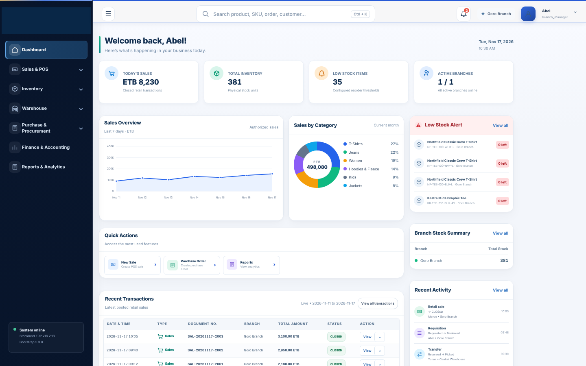
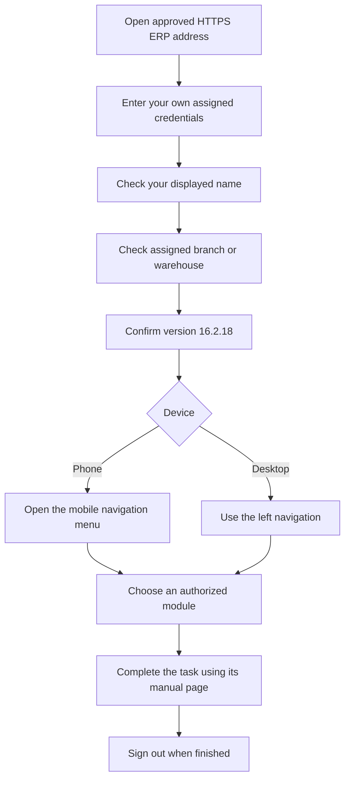
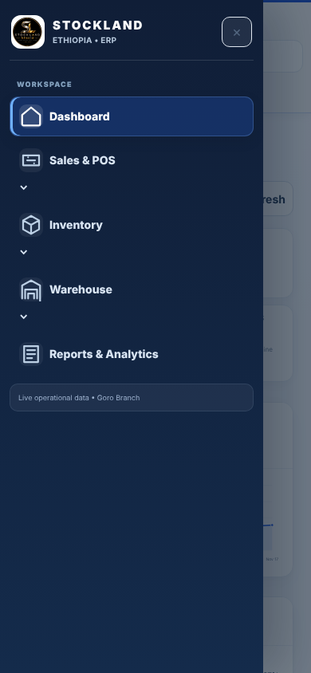

# 1. Getting started

## Open and sign in



### Open the approved Stockland ERP address

Use the production URL supplied by Stockland management. Do not substitute a development, preview or Cloudflare test URL.


### Enter your assigned account

Use the username and password provided by the authorized administrator. Never share credentials or use another employee's account.


### Confirm your identity and location

After sign-in, check your displayed user/profile identity and assigned branch or warehouse. If the location is incorrect, stop and request an administrator correction before processing transactions.

<figure><figcaption>
Signed-in landing screen: user name, assigned location and the Command Center dashboard. Role shown: Branch Manager. Stockland ERP 16.2.18 front end with training sample data.
</figcaption></figure>


### Confirm the release

The ERP shell identifies the running build. This manual applies to the approved 16.2.18 production release only.



## Figure 1 — First sign-in and navigation

*Figure 1 shows the sign-in checks and the two navigation layouts. It does not depict an actual captured screen.*

## Workspace layout

The application has a Stockland-branded shell, left navigation, top header and page content. On phones, open the mobile menu to reach navigation. On desktop, the navigation can be collapsed.

## Command launcher

The application supports a command launcher. Press Ctrl + K on Windows/Linux or Command + K on macOS, then search for an authorized module and select it.

## Sign out

Use the account/profile menu and sign-out action. On a shared computer, close the ERP tab after signing out.

## Phone and PWA use

The application is responsive and includes PWA support. Use the approved HTTPS ERP URL. If your organization enables installation on a device, use the browser's supported install option. Installing the web app does not grant additional permissions.

<figure><figcaption>
Mobile navigation drawer on a phone-sized screen. Role shown: Sales Employee. Stockland ERP 16.2.18 front end with training sample data.
</figcaption></figure>
