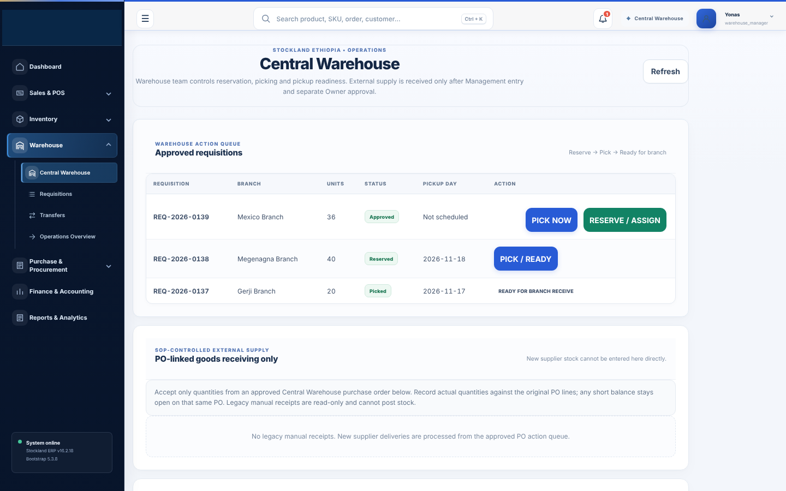
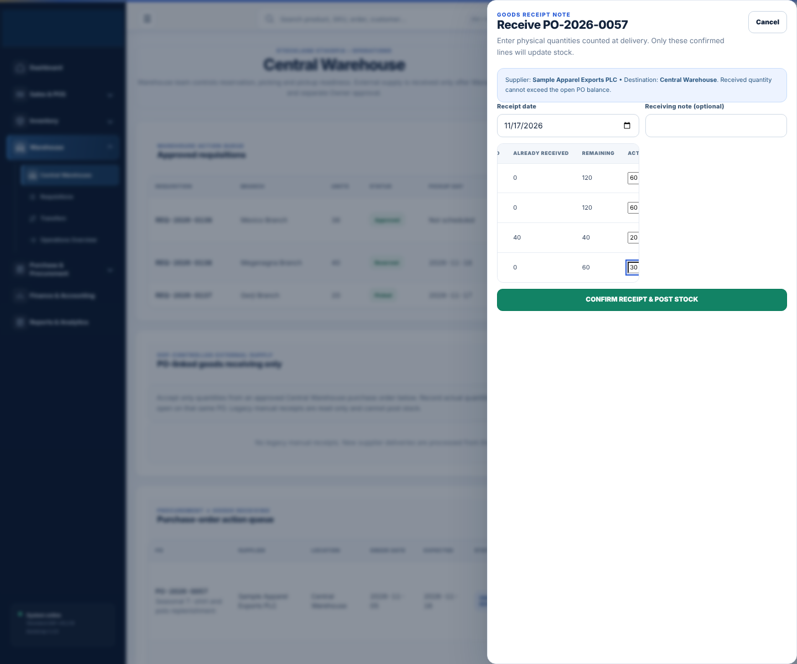
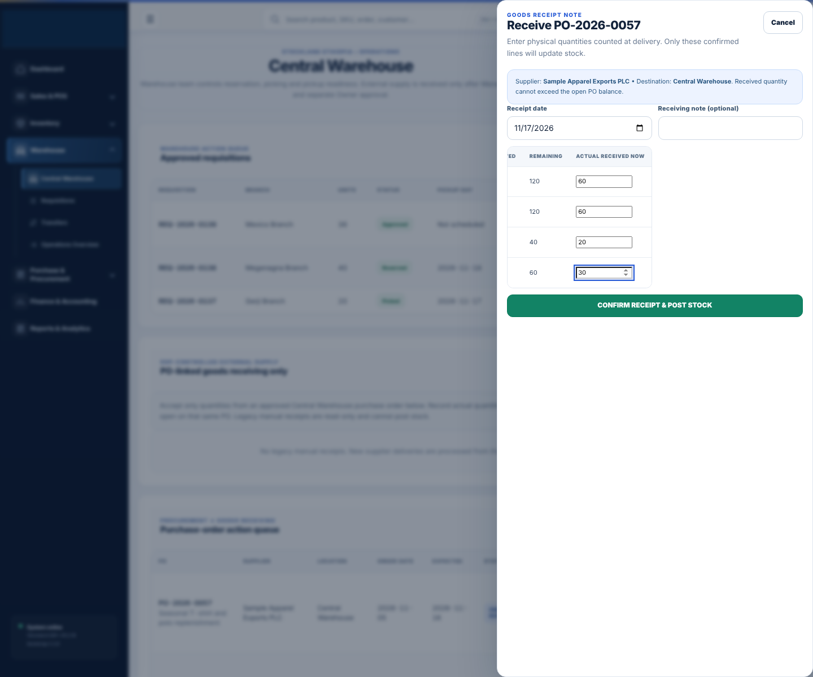

# 8. Central Warehouse and receiving

Central Warehouse manages approved branch demand, reservation, picking and pickup readiness. External supplier goods enter inventory through the controlled purchase-order receiving workflow.

## Figure 1 — Central Warehouse operating paths

```mermaid
flowchart TD
    subgraph BranchDemand["Branch demand"]
      A["Branch submits requisition"] --> B["Management / Owner approves"]
      B --> C["Central Warehouse queue"]
      C --> D["Warehouse Manager reserves and assigns pickup"]
      D --> E["Warehouse picks and marks READY"]
      E --> F["Branch receives and confirms"]
    end
    subgraph SupplierStock["Supplier purchase"]
      G["Management creates purchase order"] --> H["Owner approves stock purchase"]
      H --> I["Approved PO appears in receiving queue"]
      I --> J["Warehouse checks original PO lines vs delivery"]
      J --> K["Submit PO-linked receipt"]
      K --> L["Verify Central Warehouse stock and receipt"]
    end
```

*Figure 1 separates branch fulfillment from supplier receiving. A branch requisition is not a supplier PO, and supplier stock must be received against an approved PO. Free-form manual receipts do not post inventory in 16.2.18.*

## Warehouse requisition queue



### Open Central Warehouse

Choose Warehouse → Central Warehouse.


### Review approved requisitions

The queue lists approved requisitions waiting for warehouse action, including branch, approved units, status and pickup date.

<figure><figcaption>
Approved requisition queue with pick and reserve actions. Role shown: Warehouse Manager. Stockland ERP 16.2.18 front end with training sample data.
</figcaption></figure>


### Reserve and assign pickup

A Warehouse Manager can select RESERVE / ASSIGN for an approved requisition and choose the branch pickup date. This reserves approved quantity and records the pickup appointment.


### Pick the goods

The authorized warehouse role selects PICK / READY after the work has been reserved. A Warehouse Manager may also use PICK NOW for an approved requisition when that action is available.


### Hand over for branch receipt

After picking, the queue shows the items are ready for branch receipt. The receiving branch confirms receipt in the transfer/requisition workflow.



## Supplier goods receiving


16.2.18 uses PO-linked goods receiving. New supplier stock cannot be entered as a free-form manual receipt.




### Confirm the approved purchase order

Management enters the purchase order and the Owner completes the separate stock-purchase approval. Warehouse receives only against the approved PO.


### Open the receiving queue

In Central Warehouse, review the purchase-order action queue and open the approved PO awaiting receiving.


### Compare delivery with the PO

Check each original PO line, SKU, unit and actual delivered quantity. Record actual quantities against those same lines.

<figure><figcaption>
Goods receipt note: PO lines to compare with the delivery. Role shown: Warehouse Manager. Stockland ERP 16.2.18 front end with training sample data.
</figcaption></figure>


### Confirm receipt

Submit the PO-linked receipt using the available receiving action. A short balance remains open on the same PO; do not create a second manual receipt to hide a shortage.

<figure><figcaption>
Received quantities and CONFIRM RECEIPT & POST STOCK. Role shown: Warehouse Manager. Stockland ERP 16.2.18 front end with training sample data.
</figcaption></figure>


### Verify inventory

Check Central Warehouse stock and the related purchase-order/receipt record. Investigate variance before further transfer or sale.



Legacy manual receipt records are read-only exceptions and cannot post stock in this release.
