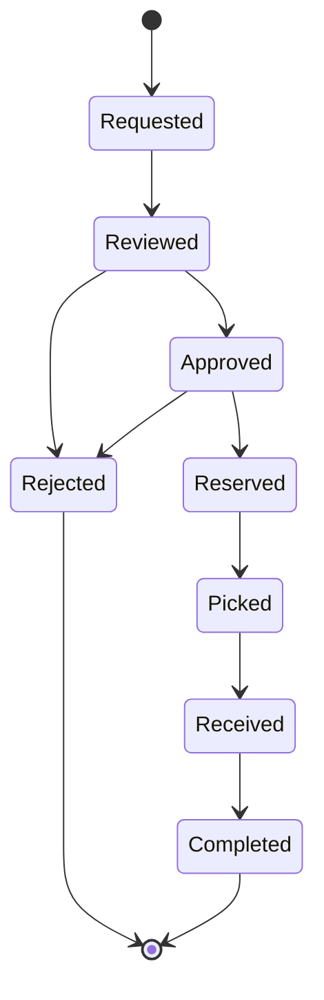
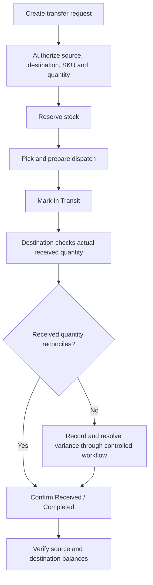
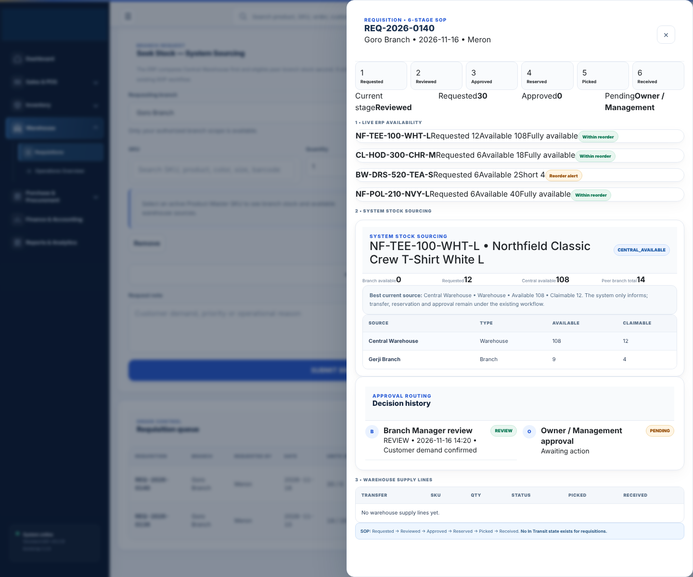
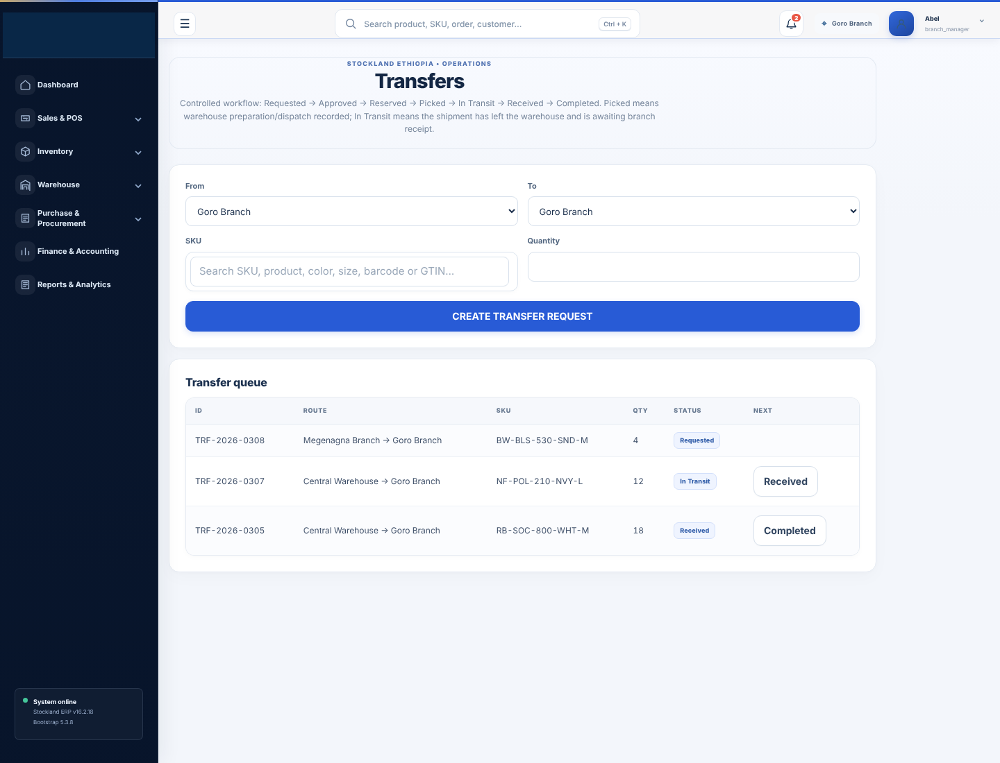

# 9. Requisitions and transfers

## Figure 1 — Requisition lifecycle

*Figure 1 illustrates the normal branch-demand lifecycle. A transfer has its own location-to-location controls and dispatch/receipt evidence; a Picked status is not the same as destination receipt.*

## Figure 2 — Transfer dispatch and receipt

*Figure 2: dispatch is not receipt. Destination staff must confirm the actual goods received before the transfer is treated as complete.*

## Create a requisition



### Open Requisitions

Choose Warehouse → Requisitions.


### Select branch and item

Confirm the authorized branch, select the live Product Master SKU and enter the requested quantity and required details.


### Submit

Submit the requisition and note its reference and Requested status.


### Track stages

The normal workflow is Requested → Reviewed → Approved → Reserved → Picked → Received. Available actions depend on role and current stage.

<figure><figcaption>
Requisition detail with the six stages and approval routing. Role shown: Branch Manager. Stockland ERP 16.2.18 front end with training sample data.
</figcaption></figure>



## Review and approval

Management/Owner reviews demand according to authority. Check SKU, quantity, branch and available stock before approval. If requested quantity exceeds availability, follow the application's shortage/availability result; do not approve an impossible quantity or create a false stock balance.

## Central Warehouse fulfillment

- Warehouse Manager: reserve approved stock and assign pickup, or use the permitted direct-pick action.
- Warehouse Employee: pick/mark ready after reservation.
- Branch recipient: confirm receipt when goods arrive.
- The requisition status and audit trail are evidence of progress.

## Create and complete a transfer



### Open Transfers

Choose Warehouse → Transfers.


### Create a transfer request

Select From location, To branch, SKU and quantity, then select CREATE TRANSFER REQUEST.


### Review and approve

The authorized reviewer checks source, destination, SKU and quantity. Approval is separate from reservation and dispatch.


### Reserve and pick

The authorized warehouse user reserves stock and records picking. Picked means warehouse preparation/dispatch has been recorded; it is not branch receipt.


### Mark in transit

The authorized operator records that the shipment has left the source location. The transfer becomes In Transit and awaits destination receipt.


### Receive at destination

The authorized destination user checks actual received quantity and records receipt. Resolve variance through the displayed controlled workflow.

<figure><figcaption>
Transfer queue with statuses and the next-action buttons. Role shown: Branch Manager. Stockland ERP 16.2.18 front end with training sample data.
</figcaption></figure>


### Confirm completion

Confirm the transfer shows Completed. Verify source/destination stock and review any variance record.



## Transfer status sequence

**Requested → Approved → Reserved → Picked → In Transit → Received → Completed**

Notifications are generated for key transfer stages. Trace the existing transfer reference rather than creating a duplicate request.
