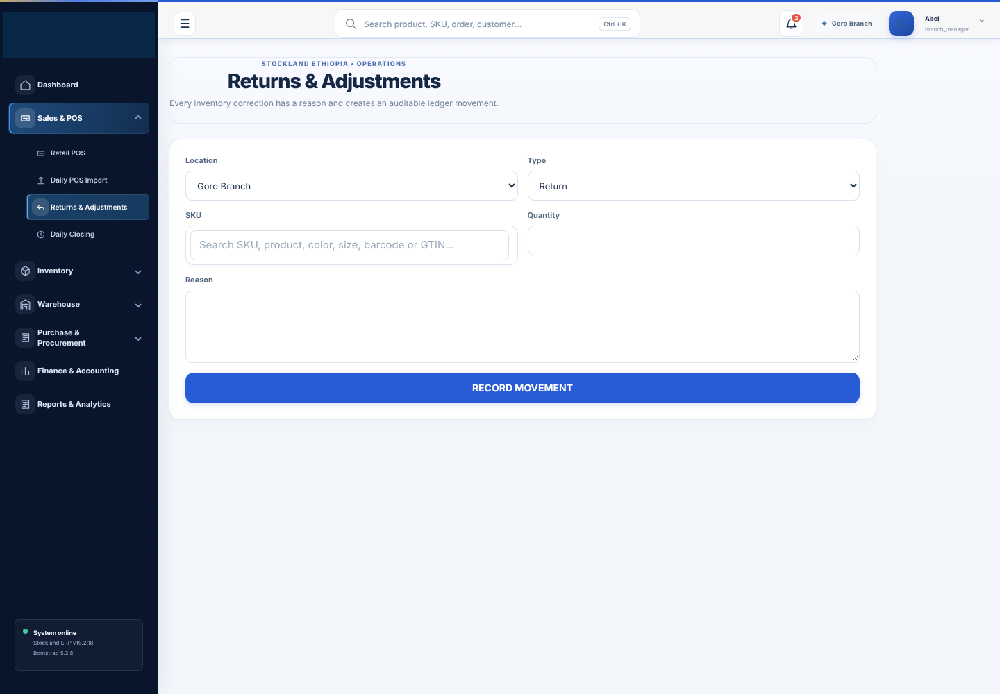
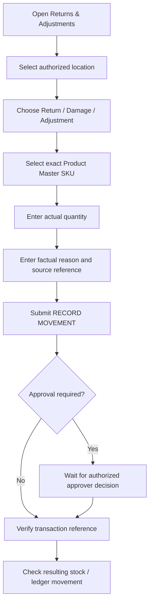

# 10. Returns, damage and adjustments

Every inventory correction requires a reason and creates an auditable ledger movement.

## Record a movement



### Open Returns & Adjustments

Choose Sales & POS → Returns & Adjustments.


### Select the location

Choose the authorized branch or warehouse where the movement occurred.


### Select the movement type

Choose Return, Damage or Adjustment. Use the type that reflects the actual event.


### Select SKU and quantity

Choose the live Product Master SKU and enter the actual quantity.


### Enter the reason

Provide a clear factual explanation and include the source transaction/reference where applicable.

<figure><figcaption>
Returns & Adjustments form: location, type, SKU, quantity and reason. Role shown: Branch Manager. Stockland ERP 16.2.18 front end with training sample data.
</figcaption></figure>


### Record the movement

Select RECORD MOVEMENT if your account is authorized. Confirm the resulting record and stock movement.



## Figure 1 — Controlled return, damage or adjustment

*Figure 1: a controlled movement is tied to a real item, location, quantity and reason. It must never be used to disguise an unrecorded sale or supplier receipt.*

## Control rules

- Do not use an adjustment to disguise an unrecorded receipt or sale.
- Do not record a return without confirming the returned item and location.
- Do not combine different SKUs, sizes or colors.
- If approval is required, wait for the authorized decision.
- Keep the original sale, transfer or count reference available for audit.

If the wrong movement type or quantity was submitted, contact the authorized manager. Do not create another movement to offset it without an approved correction instruction.
