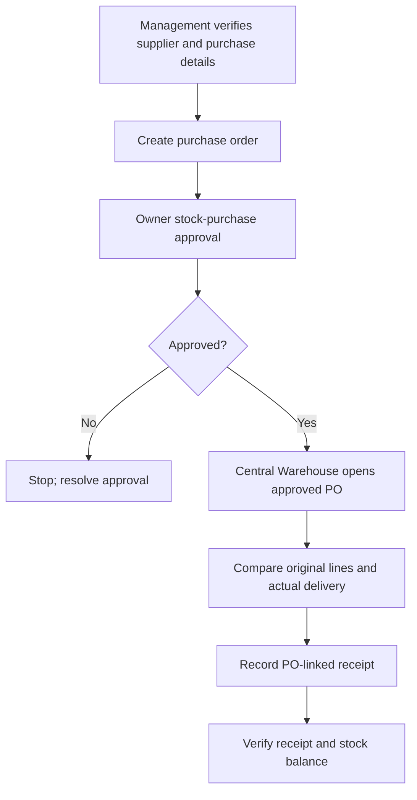
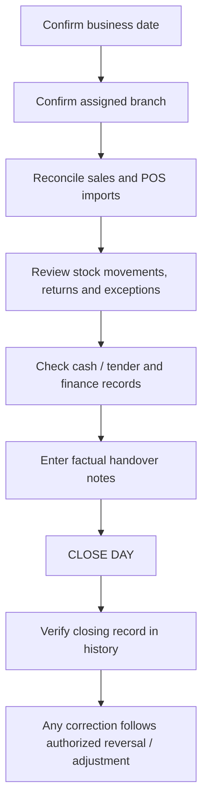

# 11. Finance, procurement and daily closing

Finance & Accounting is role-sensitive. Management has the main corporate supplier/customer, purchase-order, payment and expense controls. Branch Managers and Warehouse Managers may see a location-scoped expense workspace. Owner/Management controls corporate expenses and approval authority.

## Figure 1 — Purchase order to stock receipt

*Figure 1: PO creation and stock-purchase approval are separate from warehouse receiving. Record only goods actually delivered against the approved PO lines.*

## Purchase orders and supplier receiving



### Open Finance & Accounting

Choose Purchase & Procurement → Finance & Accounting, or the Finance & Accounting item if displayed separately.


### Verify supplier and purchase data

Confirm supplier identity and purchase details before entering a purchase order.


### Create the purchase order

Management uses the purchase-order form where authorized. Enter actual supplier, date, line items, SKU, quantity and approved cost information.


### Obtain Owner approval

Stock-purchase approval is separate from PO entry. Wait for Owner approval before warehouse receiving.


### Receive against the approved PO

The Central Warehouse Manager records actual delivered quantities against the original PO lines. Short balances remain open on the same PO.



## Suppliers and customers

Use supplier/customer master controls available to your role. Verify identity and code before saving. Resolve duplicate codes rather than working around them with invented variations.

## Accounts payable and payments

Check supplier, invoice reference, date, amount and supporting evidence. Do not record a payment until it has actually been authorized and made. Verify the resulting payable balance and journal evidence.

## Accounts receivable and customer invoices

Confirm customer identity and source sale/invoice reference. Use the approved invoice and receipt workflow. Do not use a customer invoice to re-enter a retail POS sale already posted.

## Expenses

- Branch Manager: location-scoped expense authority for the assigned branch.
- Warehouse Manager: Central Warehouse expense authority.
- Owner/Management: corporate expense controls according to capability.

Enter the actual expense date, category, description, amount, tax information and supporting reference. The location expense interface states that decisions are locked, audited and journal-posted transactionally.

## General Ledger and PLEDGER

Use ledger views for review and reconciliation. Posted journal entries should balance. Do not edit historical journal rows or correct them through direct database changes. Report discrepancies with the transaction reference.

## Figure 2 — Daily close sequence

*Figure 2: complete the operational checks before closing. The closed record is locked; never rewrite history to correct a mistake.*

## Daily Closing



### Open Daily Closing

Choose Sales & POS → Daily Closing.


### Select the business date

Confirm the business date being closed.


### Confirm the branch

Select the authorized branch or verify the read-only assigned branch.


### Enter closing notes

Add factual notes about exceptions, handovers or reconciliations.


### Close the day

Select CLOSE DAY only after sales and operational checks are complete.


### Verify the closed history

Confirm the closing record. Closed history cannot be edited; corrections require an authorized reversal or adjustment workflow.



Never invent VAT rates, payroll deductions, supplier balances, customer receipts or opening ledger values. Use approved Stockland finance policy and authorized source documents.
