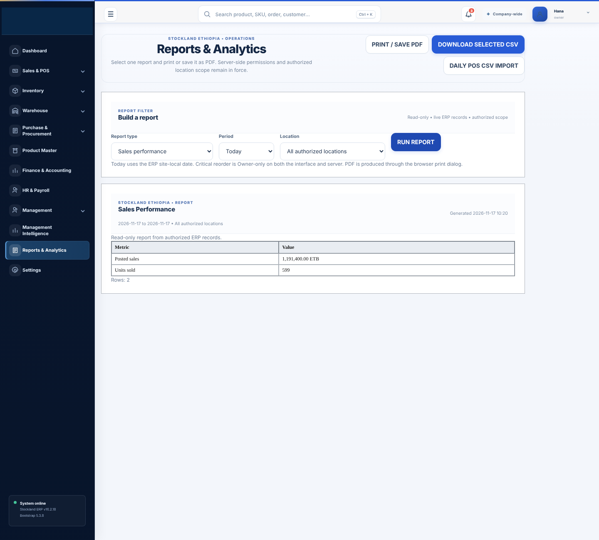
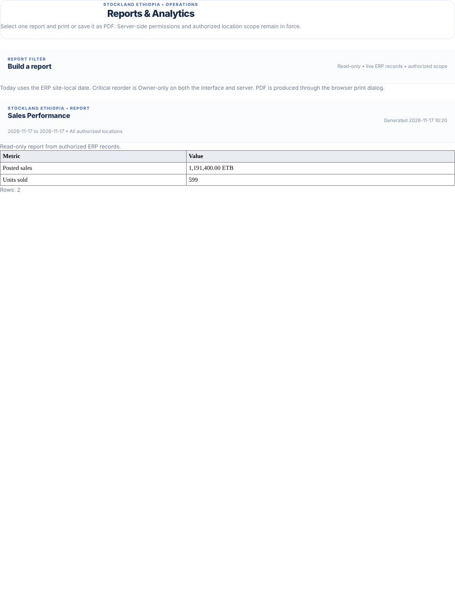
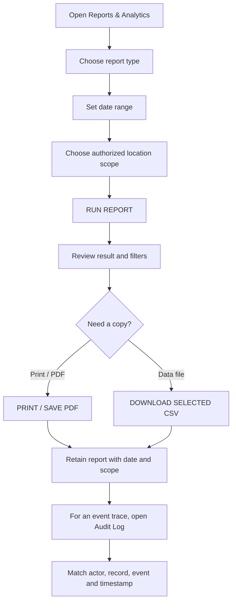
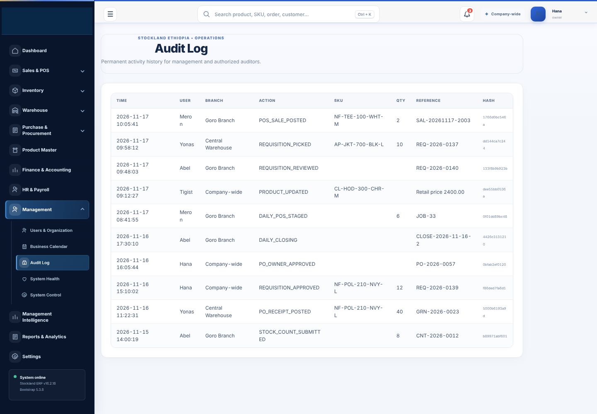

# 12. Reports and audit

## Build a report



### Open Reports & Analytics

Choose Reports & Analytics from navigation.


### Select report type

Available report types include Branch performance, Sales performance, Product / SKU performance, Inventory availability, Transfer status, Transfer variance, Physical-count variance and Returns & adjustments summary. Critical reorder is Owner-only.


### Select the period

Choose Today, Yesterday, Last 7 days, This month or Custom range.


### Select location scope

Choose All authorized locations or a specific authorized branch/warehouse. The server enforces your access scope.


### Run the report

Select RUN REPORT and wait for the live result.

<figure><figcaption>
Report filters and a generated report. Role shown: Owner. Stockland ERP 16.2.18 front end with training sample data.
</figcaption></figure>


### Print or export

Use PRINT / SAVE PDF for a printable report or DOWNLOAD SELECTED CSV for the selected report data, when enabled.

<figure><figcaption>
Print layout used by PRINT / SAVE PDF. Role shown: Owner. Stockland ERP 16.2.18 front end with training sample data.
</figcaption></figure>



## Figure 1 — Report and audit review

*Figure 1: reports are read-only analysis. Audit Log is the trace of recorded events; neither is an edit path for correcting transactions.*

## Daily Inventory versus Reports

Daily Inventory is a read-only ledger-derived stock movement view. Reports & Analytics is a report builder for performance, availability, transfers, counts and returns. Neither screen is a stock-entry function.

## Audit Log

Use Management → Audit Log when authorized. Inspect the relevant user, record and event. Use transaction reference and timestamp to trace what happened. An audit record is evidence, not an edit control.

<figure><figcaption>
Audit Log: time, user, branch, action, reference and hash. Role shown: Owner. Stockland ERP 16.2.18 front end with training sample data.
</figcaption></figure>

## Reconciliation checklist

- Date and location match the intended business period.
- Report type matches the question being investigated.
- User has the correct authorized scope.
- Source documents and transaction references are retained.
- Differences are resolved through the proper workflow, not by editing history.
