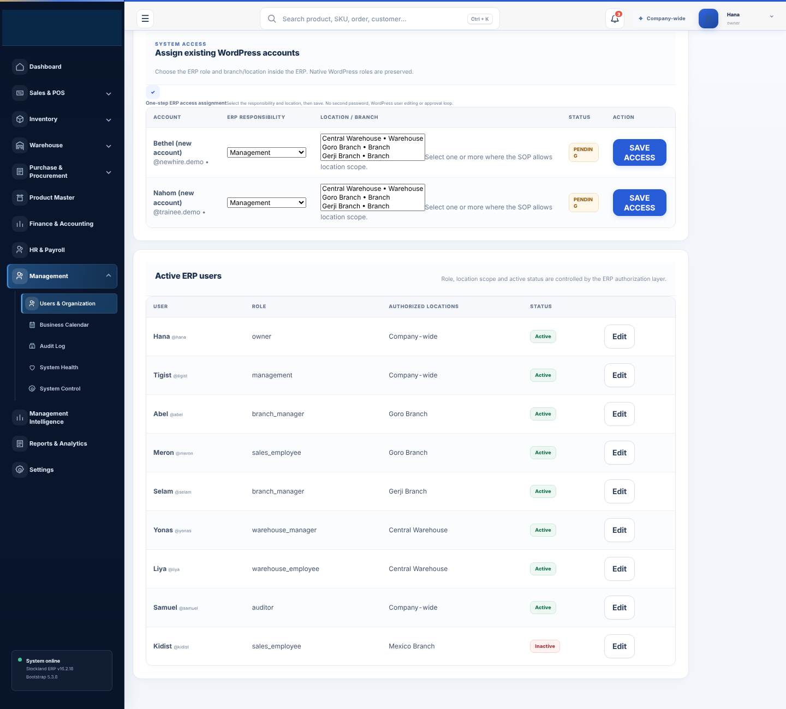
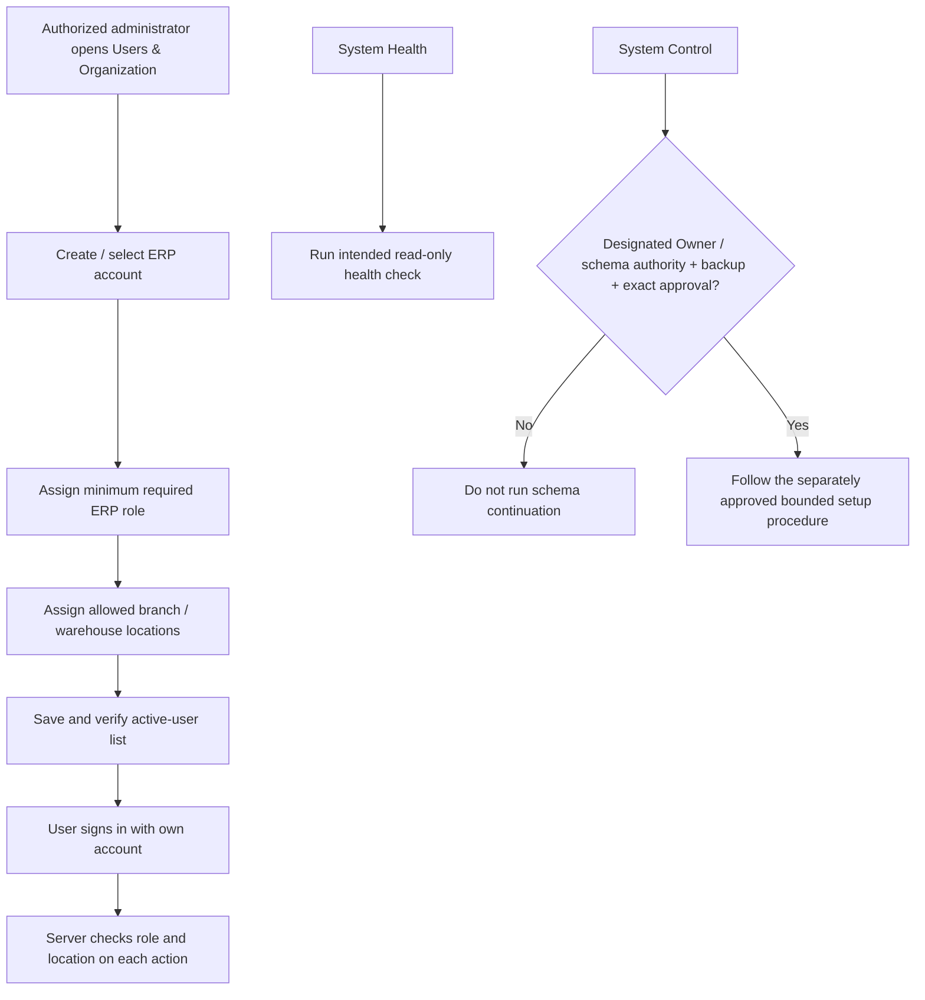
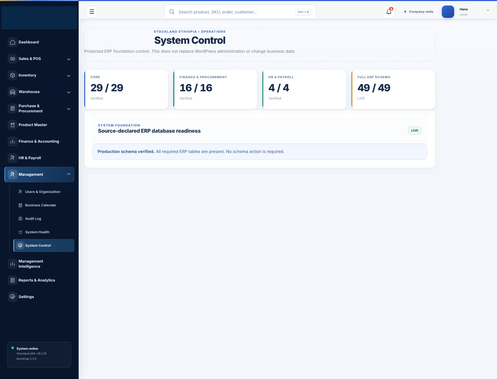

# 13. Users, settings and system control

## Users & Organization

This is the ERP front-end access center. Authorized administrators can create ERP users, assign roles and set permitted locations.



### Open Users & Organization

Choose Management → Users & Organization.


### Create an ERP user

Where permitted, complete Username, Display name, Email, Password and ERP role.


### Assign locations

Select the branch/warehouse locations the user may access. The first selected location is the primary location.


### Create the user

Select CREATE ERP USER and verify the user in the active-user list.


### Assign an existing account

Use the existing WordPress account assignment area to attach ERP role and location scope. Existing WordPress roles are preserved.

<figure><figcaption>
Assign an existing WordPress account: ERP role, location scope and SAVE ACCESS. Role shown: Owner. Stockland ERP 16.2.18 front end with training sample data.
</figcaption></figure>



Only the Owner can assign the Owner role through the user-creation selector. Assign the minimum access required for the employee's work.

## Figure 1 — Access setup and protected system controls

*Figure 1: assigning a role or location is an access-control change. Health checks and protected schema operations have separate authority; ordinary ERP work does not require WordPress Dashboard access.*

## Business Calendar and Settings

Business Calendar controls operating dates. Closed dates can block posting. Coordinate changes with Management.

System Settings includes central business identity, VAT rate/basis and branch/central reorder alert values. Only authorized users should change these values. Do not change tax settings based on an unverified assumption.

## System Health

System Health provides RUN QUICK HEALTH CHECK and RUN DEEP INTEGRITY AUDIT. The deep audit is read-only but can take longer on shared hosting. Run it intentionally during a quiet period and follow IT/Management instructions.

## System Control

System Control is a protected ERP foundation page. It is not the normal business operations workspace and does not replace WordPress administration.

- It reports Core, Finance & Procurement, HR & Payroll and full-schema status.
- A protected setup continuation action is shown only to an authorized schema administrator.
- It advances bounded setup work and does not delete or reseed business records.
- Owner go-live authorization is tied to the release version and exact schema fingerprint.

Do not run schema actions unless you are the designated Owner/schema administrator and have completed the required backup and approval steps.

<figure><figcaption>
System Control: schema readiness. Role shown: Owner. Stockland ERP 16.2.18 front end with training sample data.
</figcaption></figure>

## WordPress administration

Ordinary ERP users should work in the ERP front end. Native WordPress Dashboard remains a separate technical administration area for authorized site administrators.
