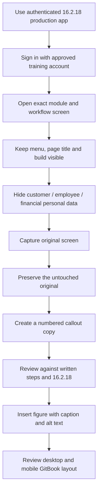

# 15. Screenshot capture checklist

The written instructions are grounded in 16.2.18 source. To make this a fully visual screen-by-screen manual, capture these screens from the authenticated 16.2.18 production application. Do not use development builds, mockups, sample data or screenshots from later releases.

## Capture rules

- Capture the actual Stockland ERP screen with the 16.2.18 build visible where practical.
- Use an approved training account and non-sensitive training records.
- Hide customer and employee personal data, email addresses, phone numbers, credentials, payroll amounts and private HR documents.
- Never capture passwords, nonces, API keys, private vault paths or browser developer tools.
- Keep the menu and page title visible.
- Retain the unmodified original capture securely before adding numbered callouts.
- Capture desktop and phone views where the workflow is commonly performed on both.

## Figure 1 — From real screen to approved manual image

*Figure 1: screenshots must come from the installed 16.2.18 application and be privacy-reviewed. Mermaid workflow diagrams in this manual are supplementary figures, not substitutes for these captures.*

## Required capture set

| ID | Real screen to capture | Manual page |
|---|---|---|
| S01 | ERP sign-in and successful landing | Getting started |
| S02 | Desktop navigation expanded | Command Center |
| S03 | Mobile navigation open | Getting started |
| S04 | Command launcher search result | Command Center |
| S05 | Product Master search results with SKU/size/color | Product Master |
| S06 | Product Master new/edit form | Product Master |
| S07 | Product Master bulk import preview | Product Master |
| S08 | Inventory Control search and location stock | Inventory and counts |
| S09 | Daily Inventory report filters and movement columns | Inventory and counts |
| S10 | Physical Count workbook preview | Inventory and counts |
| S11 | Count batch variance and approval controls | Inventory and counts |
| S12 | Retail POS sale header and empty cart | Retail POS |
| S13 | Retail POS populated cart and totals | Retail POS |
| S14 | POS successful posting/reference | Retail POS |
| S15 | Daily POS manual upload form | Daily POS Import |
| S16 | Daily POS validation/reconciliation preview | Daily POS Import |
| S17 | Daily POS staged queue and Branch Manager review | Daily POS Import |
| S18 | Daily POS release confirmation/result | Daily POS Import |
| S19 | Central Warehouse approved requisition queue | Central Warehouse |
| S20 | PO receiving queue and line receipt | Central Warehouse |
| S21 | Requisition stages | Requisitions and transfers |
| S22 | Transfer stages and destination receipt | Requisitions and transfers |
| S23 | Returns & Adjustments form | Returns and adjustments |
| S24 | Finance & Accounting overview | Finance and procurement |
| S25 | Daily Closing form and result | Finance and procurement |
| S26 | Reports filter and printed report preview | Reports and audit |
| S27 | Audit Log record detail | Reports and audit |
| S28 | Users & Organization role/location assignment | Users and settings |
| S29 | System Health result | Users and settings |
| S30 | System Control schema status with sensitive details hidden | Users and settings |

## Capture status

| Status | Screens |
|---|---|
| Inserted (16.2.18 front end, training sample data) | S01–S28 and S30, with extra variants S17b, S20b and S26b |
| Not captured | S29 System Health result. The 16.2.18 System Health screen throws `quickOnly is not defined` instead of showing a result. |
| Still required | A production capture of each screen from the installed 16.2.18 application with an approved training account, privacy-reviewed, to replace the sample-data images. |

The inserted images are real renderings of the shipped 16.2.18 interface fed with synthetic data. They do not satisfy the production-capture rule above, so this checklist stays open.

## Insert screenshots in GitBook

1. Open the relevant page in GitBook.
2. Add an image block immediately after the step it illustrates.
3. Upload the approved screenshot and write useful alternative text.
4. Add a caption naming the page and the 16.2.18 screen.
5. Check desktop and mobile rendering in Preview.
6. Submit the updated page for review before publishing.

Do not mark this checklist complete until every required screenshot is captured from the real installed 16.2.18 app, reviewed for privacy and matched to the written steps.
