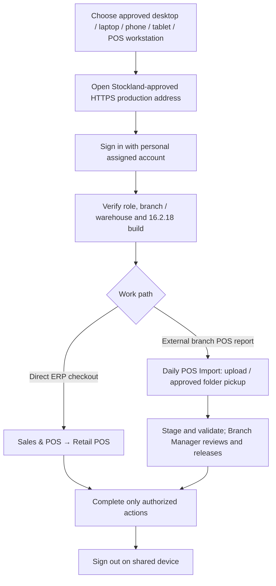
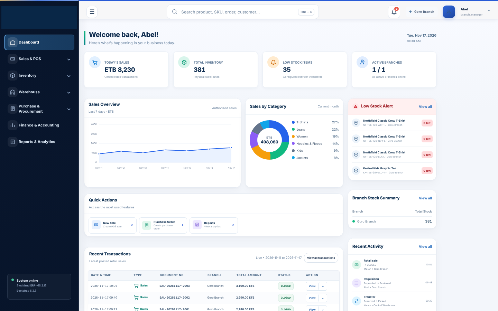
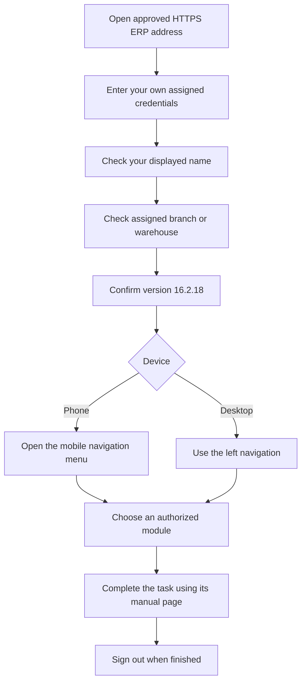
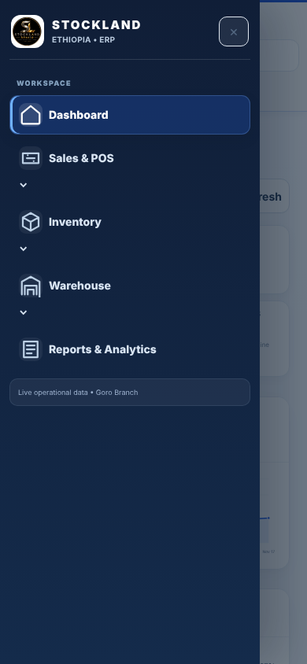

# 1. Getting started

## Device connection options

Stockland ERP 16.2.18 is accessed through its approved HTTPS web address. The same company-approved address is used from a supported desktop/laptop browser, a phone/tablet browser, or a company-approved workstation used for Retail POS. Management supplies the production address; staff must not substitute a development, preview or Cloudflare test address.

| Device / work option       | How to connect                                                                                                                            | Where to work                                                                                                                                                                                             |
| -------------------------- | ----------------------------------------------------------------------------------------------------------------------------------------- | --------------------------------------------------------------------------------------------------------------------------------------------------------------------------------------------------------- |
| Desktop or laptop          | Open the management-approved HTTPS ERP address in the browser and sign in with your assigned account.                                     | Use the left navigation or the command launcher.                                                                                                                                                          |
| Phone or tablet            | Open the same approved HTTPS address in the device browser, then sign in with your own account.                                           | Open the mobile navigation drawer. Install the PWA only when Stockland enables installation for that device.                                                                                              |
| Retail POS workstation     | Use an approved desktop or tablet browser with the same ERP address and an authorized Sales Employee or Branch Manager account.           | Open Sales & POS → Retail POS. This is access to the ERP's browser-based POS screen; it does not establish automatic pairing with a payment terminal, receipt printer, cash drawer or barcode peripheral. |
| External branch POS report | Keep the original branch POS report and use the supported manual XLSX/CSV upload, or the optional approved Windows Incoming-folder agent. | Sales & POS → Daily POS Import. Both methods stage the file; the Branch Manager separately reviews and RELEASES TO ERP. No vendor POS API is connected in 16.2.18.                                        |

## Connect a device to the ERP



### Choose an approved device

Use a Stockland-approved desktop/laptop, phone/tablet or Retail POS workstation with internet access and a supported browser. Do not use another employee's saved session.



### Open the production address

Type or open the HTTPS address supplied by Stockland Management. Check the address before entering credentials. If it shows a development, preview or Cloudflare test host, stop and request the approved URL.



### Sign in with your own account

Enter the assigned username and password. Never share credentials or create a shared staff login.



### Verify the session

Check your displayed user, ERP role, assigned branch/warehouse and the build label for 16.2.18. If the role or location is wrong, sign out and ask the administrator to correct the assignment before doing work.



### Open the correct work area

For direct ERP checkout, open Retail POS. For a completed external branch POS report, use Daily POS Import and follow the separate staging and Branch Manager release procedure.



### Optional phone installation

If Stockland has enabled PWA installation, use the browser's supported install option. Installation is only a convenient way to open the same ERP web application; it does not grant extra permissions or change your assigned role/location.



### Sign out on shared devices

Use the account/profile sign-out action when finished. Close the ERP tab on a shared workstation.



## Device-to-ERP connection path

_Training diagram: the supported device paths lead to the same role- and location-controlled ERP session. It illustrates browser access and the documented import workflow; it is not a screenshot or evidence of peripheral hardware integration._

## Open and sign in



### Open the approved Stockland ERP address

Use the production URL supplied by Stockland management. Do not substitute a development, preview or Cloudflare test URL.



### Enter your assigned account

Use the username and password provided by the authorized administrator. Never share credentials or use another employee's account.



### Confirm your identity and location

After sign-in, check your displayed user/profile identity and assigned branch or warehouse. If the location is incorrect, stop and request an administrator correction before processing transactions.

_Signed-in landing screen for a Branch Manager: user name and role at top right, assigned location (Goro Branch) in the header, and the Command Center dashboard. Rendered from the exact 16.2.18 front end with synthetic training data; the figures are not live Stockland results._



### Confirm the release

The ERP shell identifies the running build. This manual applies to the approved 16.2.18 production release only.



## Figure 1 — First sign-in and navigation

_Figure 1 shows the sign-in checks and the two navigation layouts. It does not depict an actual captured screen._

## Workspace layout

The application has a Stockland-branded shell, left navigation, top header and page content. On phones, open the mobile menu to reach navigation. On desktop, the navigation can be collapsed.

### Open mobile navigation

On a phone, select the menu control to open navigation. Then select an authorized module.

_Sales Employee mobile navigation drawer on a phone-sized (390 px) screen. Exact 16.2.18 front end with synthetic training data. This image illustrates navigation only; it does not show a completed transaction._

## Command launcher

The application supports a command launcher. Press Ctrl + K on Windows/Linux or Command + K on macOS, then search for an authorized module and select it.

## Sign out

Use the account/profile menu and sign-out action. On a shared computer, close the ERP tab after signing out.

## Phone and PWA use

The application is responsive and includes PWA support. Use the approved HTTPS ERP URL. If your organization enables installation on a device, use the browser's supported install option. Installing the web app does not grant additional permissions.
