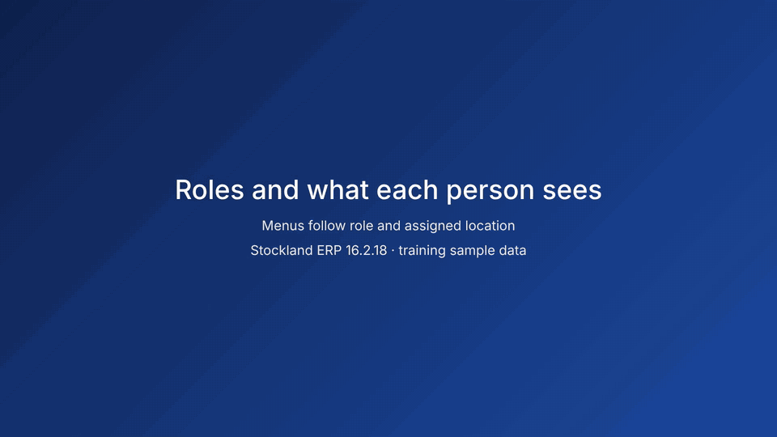
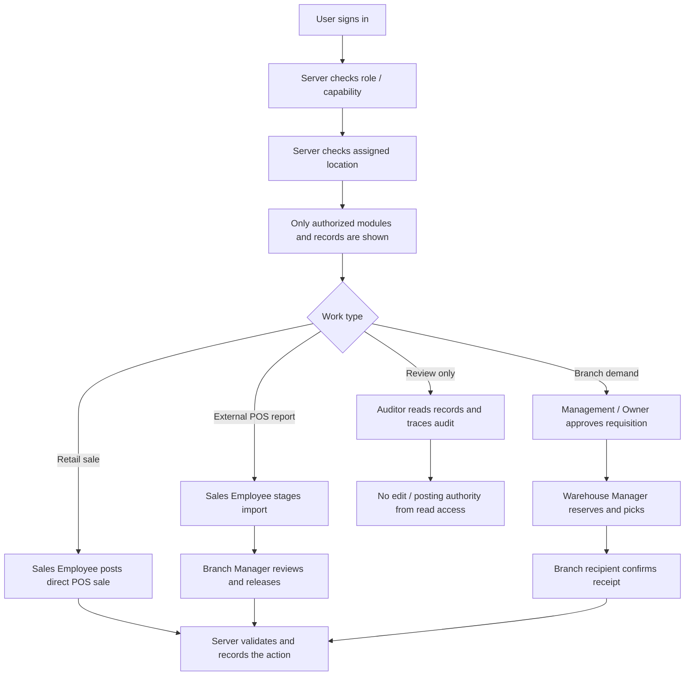

# 2. Roles and locations

Access depends on the signed-in ERP profile, capabilities and assigned location scope. The server checks authorization again when a record is changed.

## Watch the walkthrough

_The animation switches through the seven roles and highlights the navigation each one gets. Your account may see only a subset of modules. This is intentional._

## Role guide

| ERP role           | Main responsibility                                                                      |
| ------------------ | ---------------------------------------------------------------------------------------- |
| Owner              | Company-wide authority, release/schema approvals and high-level control                  |
| Management         | Review and approval, procurement and finance decisions within authority                  |
| Branch Manager     | Assigned-branch operations, demand review, Daily POS release, branch receiving and close |
| Sales Employee     | Customer sales, SKU selection, POS work and Daily POS upload/staging where assigned      |
| Warehouse Manager  | Central Warehouse fulfillment, reservation, picking and PO-linked receiving              |
| Warehouse Employee | Picking/ready work after reservation                                                     |
| Auditor            | Review records, trace activity and report exceptions                                     |

### Owner navigation — exact 16.2.18 screen

_Authentic screen structure from the 16.2.18 frontend. Displayed records are synthetic QA fixtures, not live production users or transactions._

## Figure 1 — Role, location and approval boundaries

_Figure 1: users can see different pages and actions according to their role and assigned location. Approval responsibility is separate from data entry or staging._

## Stockland locations

The 16.2.18 Stockland installation is seeded for one company and these locations:

* Central Warehouse
* Goro Branch
* Gerji Branch
* Mexico Branch
* Megenagna Branch

These are Stockland-specific locations, not generic defaults for another business.

## Location scope

* Branch staff normally work within their assigned branch.
* Warehouse staff work within their assigned warehouse responsibilities.
* Owner, Management and Auditor may have broader read access according to capabilities.
* Multi-location users may see a location selector.
* If the wrong location appears, do not use another employee's location as a workaround. Request an administrator correction.

## Maker/checker

Some actions are split between different people. A Sales Employee can stage an external POS report, but the Branch Manager must review and release it. A user cannot grant themselves authority by changing browser values or using another screen.

### Screenshot — Auditor audit view in 16.2.18

_Exact 16.2.18 frontend capture under the Auditor capability profile. Sample fixture data only; this is not an audit export or a real production audit event._

### Screenshot — Auditor reports view in 16.2.18

_Exact 16.2.18 frontend capture under the Auditor capability profile. Sample fixture data only; this does not represent live financial or branch reporting data._
