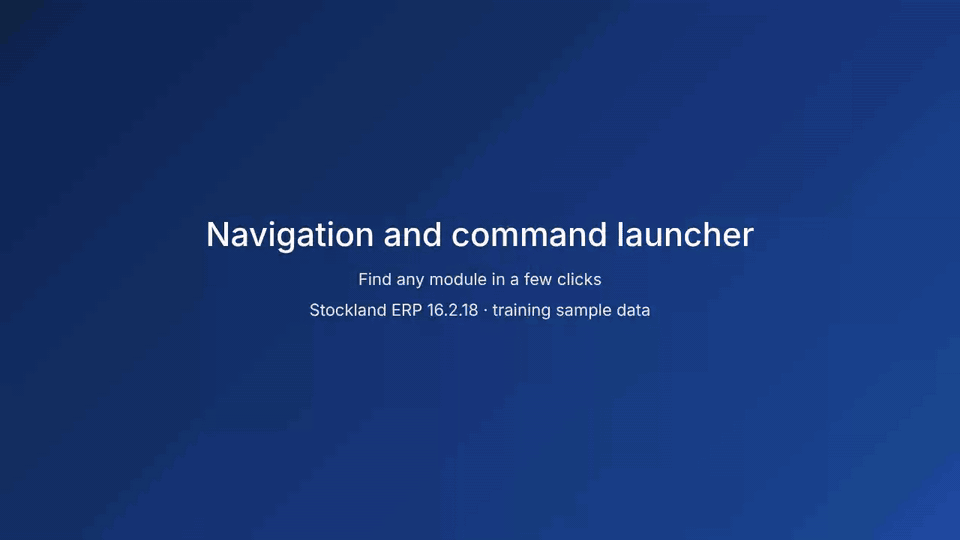
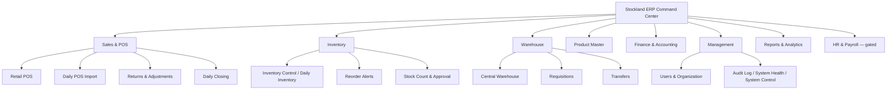
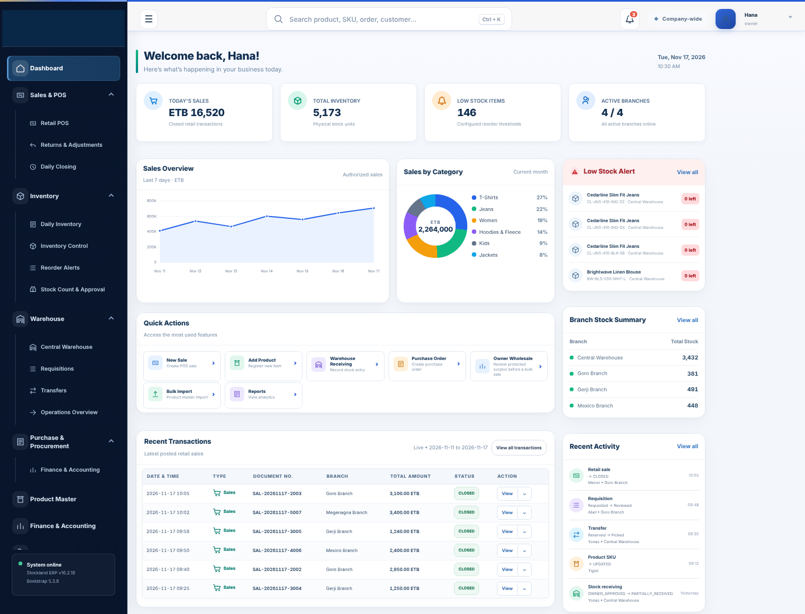
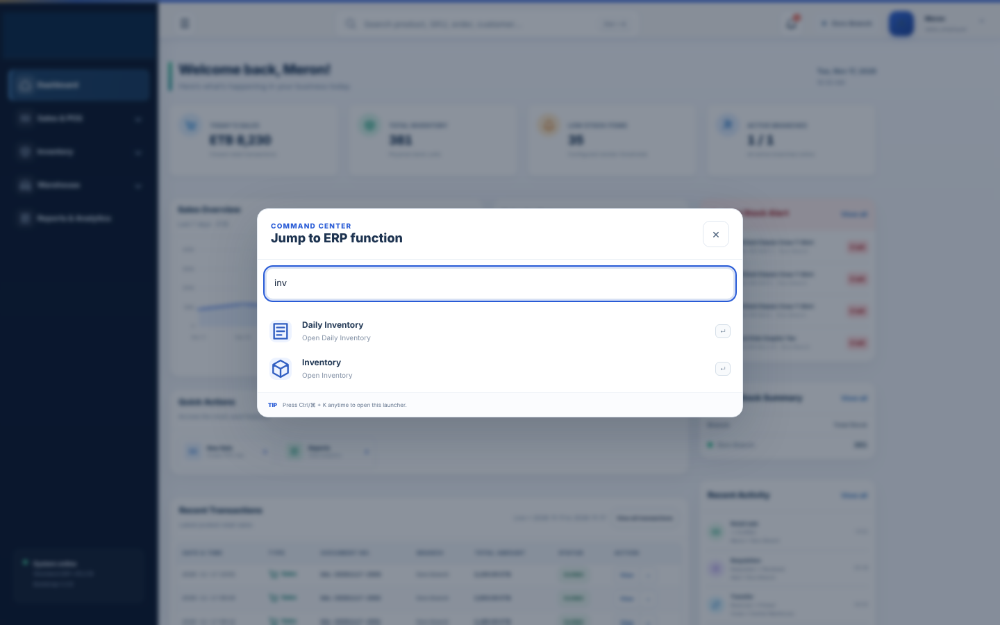

# 3. Command Center and navigation

## Watch the walkthrough

_Follow the highlighted pointer and on-screen step labels from the Command Center into an authorized work area. Available menu items depend on the signed-in user's role and location; the values shown are training samples._

## Main navigation

The actual 16.2.18 navigation groups the main functions as follows:

| Navigation group / item | Purpose                                                                           |
| ----------------------- | --------------------------------------------------------------------------------- |
| Dashboard               | Operational overview                                                              |
| Sales & POS             | Retail POS, Daily POS Import, Returns & Adjustments, Daily Closing                |
| Inventory               | Daily Inventory, Inventory Control, Reorder Alerts, Stock Count & Approval        |
| Warehouse               | Central Warehouse, Requisitions, Transfers, Operations Overview                   |
| Purchase & Procurement  | Finance & Accounting and purchase-order workflows                                 |
| Product Master          | Authoritative SKU and variant catalog                                             |
| Finance & Accounting    | Supplier/customer, expenses, payables/receivables and ledger functions            |
| HR & Payroll            | HR area subject to separate setup/statutory approval gates                        |
| Management              | Users & Organization, Business Calendar, Audit Log, System Health, System Control |
| Management Intelligence | Management-only insight views                                                     |
| Reports & Analytics     | Read-only report builder                                                          |

Items may be hidden if your account lacks the required capability.

## Figure 1 — Navigation by work area

_Figure 1 is a navigation map. A module appears only when the signed-in account has the required capability and location scope. Selecting a page does not itself authorize an approval or posting action._

## Open a module



### Open navigation

On desktop, use the left navigation. On a phone, open the mobile menu.



### Expand a group

Select a group such as Sales & POS, Inventory or Warehouse.

_Owner view with every navigation group expanded. Exact 16.2.18 front end, synthetic training data. Other roles see fewer items._



### Select the required page

Choose Retail POS, Inventory Control, Requisitions or another authorized page. Wait for the page to finish loading before submitting anything.



## Command launcher and search

Use Ctrl + K or Command + K to open the command launcher, type the module name and select an available result. Global search can locate records that your account is permitted to view. Search results do not grant edit or posting permission.

_Command launcher opened with Ctrl + K and the text "inv", listing Daily Inventory and Inventory. Exact 16.2.18 front end, synthetic training data._

## Notifications

Review notifications for requisition and transfer stage changes, approvals and exceptions. Open the referenced record and confirm its current status before taking action.

## Role-based SOP Guide

The application includes a role-based SOP Guide with suggested next actions. It is guidance only and does not create permissions or approve a transaction.

## Appearance

The Color Scheme control provides the Stockland Sapphire palette. Appearance is a local browser preference and does not change ERP data, roles or workflow behavior.
