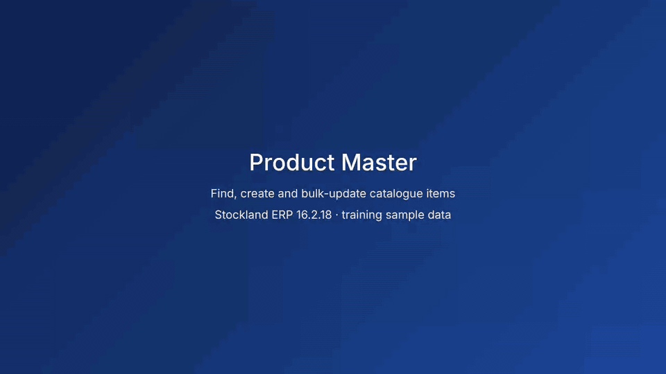
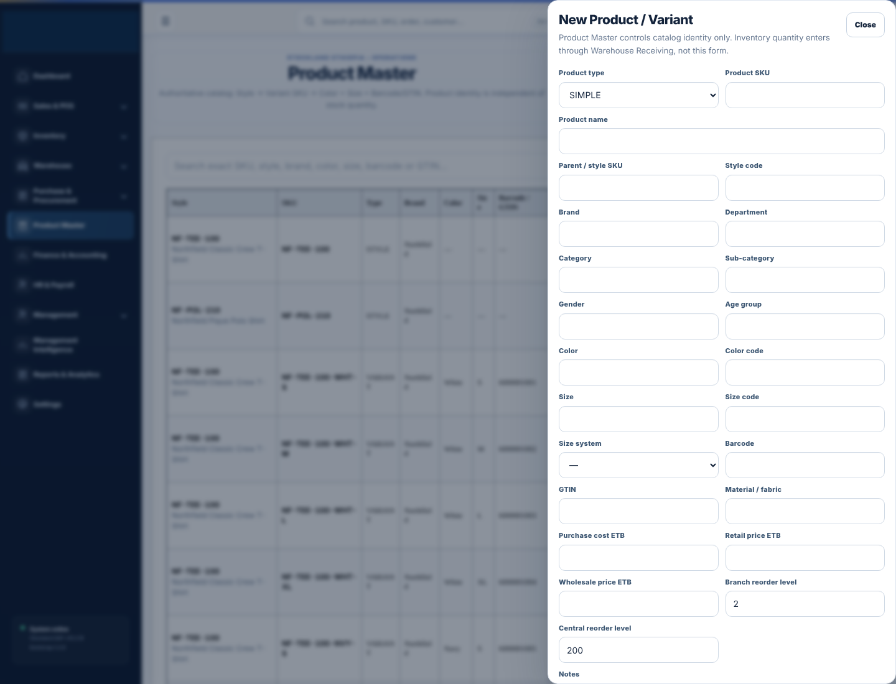
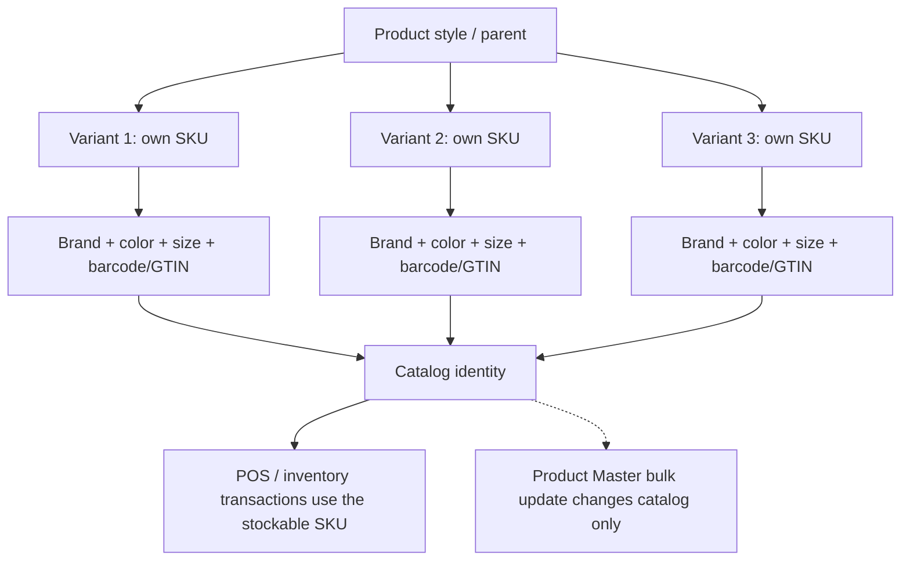
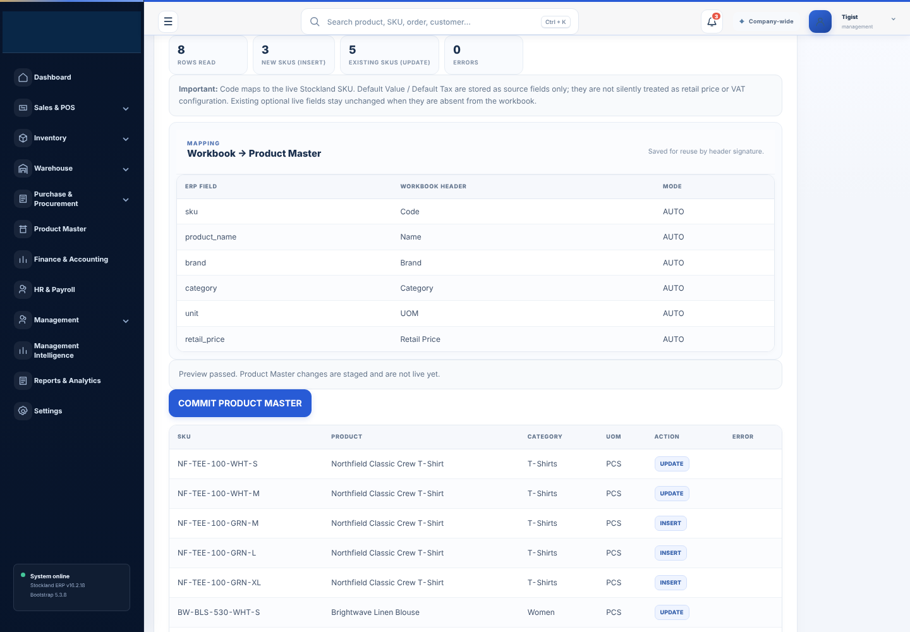

# 4. Product Master

Product Master is the authoritative catalog for product identity. A product's existence in the catalog is separate from its stock quantity.

## Watch the walkthrough

_Use the highlighted sequence to follow catalogue search and variant review, then the import preview. The workbook values are illustrative; review the actual mapping and validation before any authorized commit._

## Find a product or variant



### Open Product Master

Select Product Master from the left navigation.



### Search the catalog

Search by exact SKU, product name, parent/style SKU, style code, brand, color, size, barcode or GTIN.



### Check the variant identity

Confirm style, SKU, product type, brand, color, size, barcode/GTIN, age group, retail price and ACTIVE/INACTIVE status.



### Open or edit the record

If your account has Product Master permission, use the available new/edit action. Confirm the intended variant before saving. If the action is not shown, request an authorized Management/Owner update.

_New Product / Variant form as seen by a Management user. Exact 16.2.18 front end; nothing was saved._



## Figure 1 — Owner view: Product Master catalogue

_Figure 1: The screenshot documents the 16.2.18 Product Master screen and its controls. SKU rows and displayed prices are synthetic sample data, not a representation of current Stockland inventory or price._

## Figure 2 — Product identity and stock relationship

_Figure 2: each stockable color/size variant must resolve to its own SKU. Product Master records identify items; inventory quantities are controlled by receiving, sales, transfers, counts and approved adjustments._

## Product and variant identity

The catalog follows a style-to-variant model. A style groups related variants; each stockable variant has its own SKU. Color and size distinguish variants. Barcode and GTIN identify the item where populated. Only active, stockable variants should be selected for normal POS transactions.

Do not create a new SKU just because an item appears in Inventory. Check Product Master first.

## Bulk Product Master update

This function is restricted to Management and Owner.



### Open the import action

In Product Master, select BULK MASTER UPDATE if your account has the permission.



### Prepare the approved workbook

Use the approved Product Master Excel workbook. Keep original headings and product codes. Do not use a physical-count workbook or a third-party Daily POS report here.



### Select and preview

Choose the XLSX file and select PREVIEW PRODUCT MASTER. The application reads and maps the workbook before a master-data update is committed.



### Review mapping and validation

Check source-to-ERP field mapping, row summary, errors and warnings. Confirm that product codes resolve to the intended live Stockland SKUs.

_Preview after choosing the approved workbook: row summary (8 read, 3 INSERT, 5 UPDATE, 0 errors), source-to-ERP mapping, and the COMMIT PRODUCT MASTER button that stays unused until review is complete. Exact 16.2.18 front end; the rows are synthetic and nothing was committed._



### Commit after review

Use the commit action presented by the application only after an authorized reviewer confirms the preview. If a row is ambiguous or incorrect, stop and correct the workbook first.




Product Master import changes catalog/master data only. It does not create inventory, receive goods or post sales. Use Warehouse receiving for new supplier stock and Daily POS Import for completed external branch sales.


Do not assume a source workbook's Default Value or Default Tax column is the ERP retail price or VAT configuration. The importer treats those as source fields unless an explicit Product Master mapping says otherwise.
