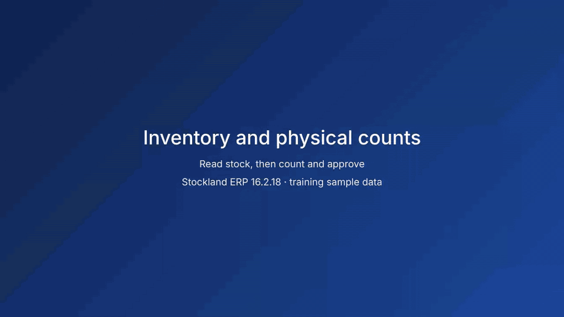
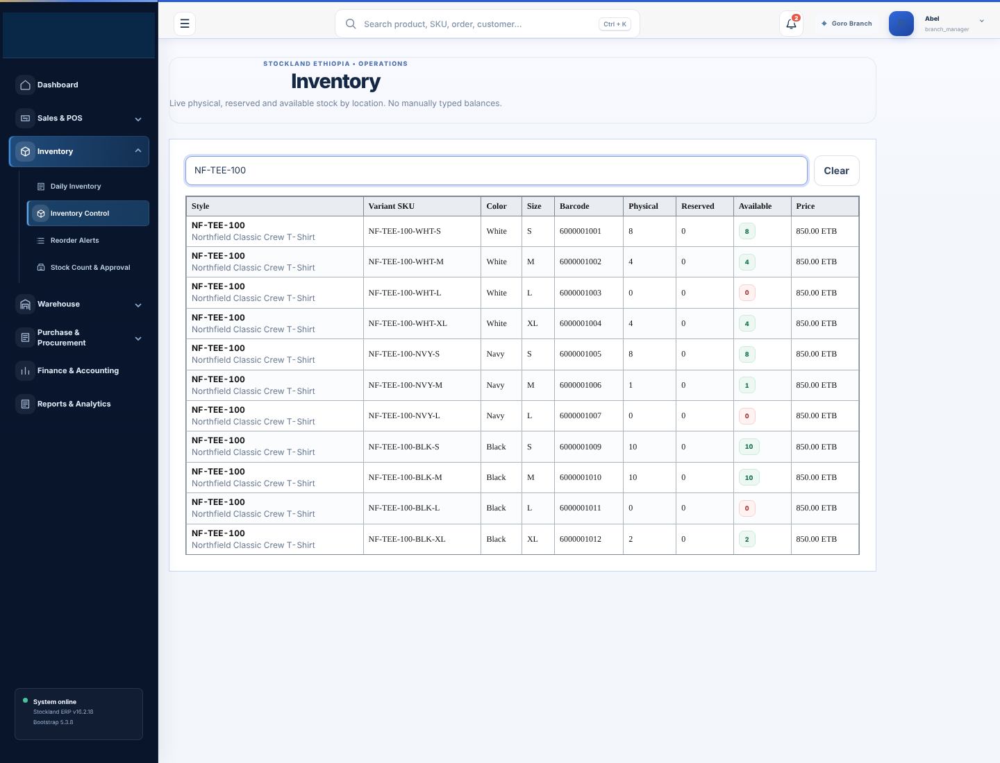
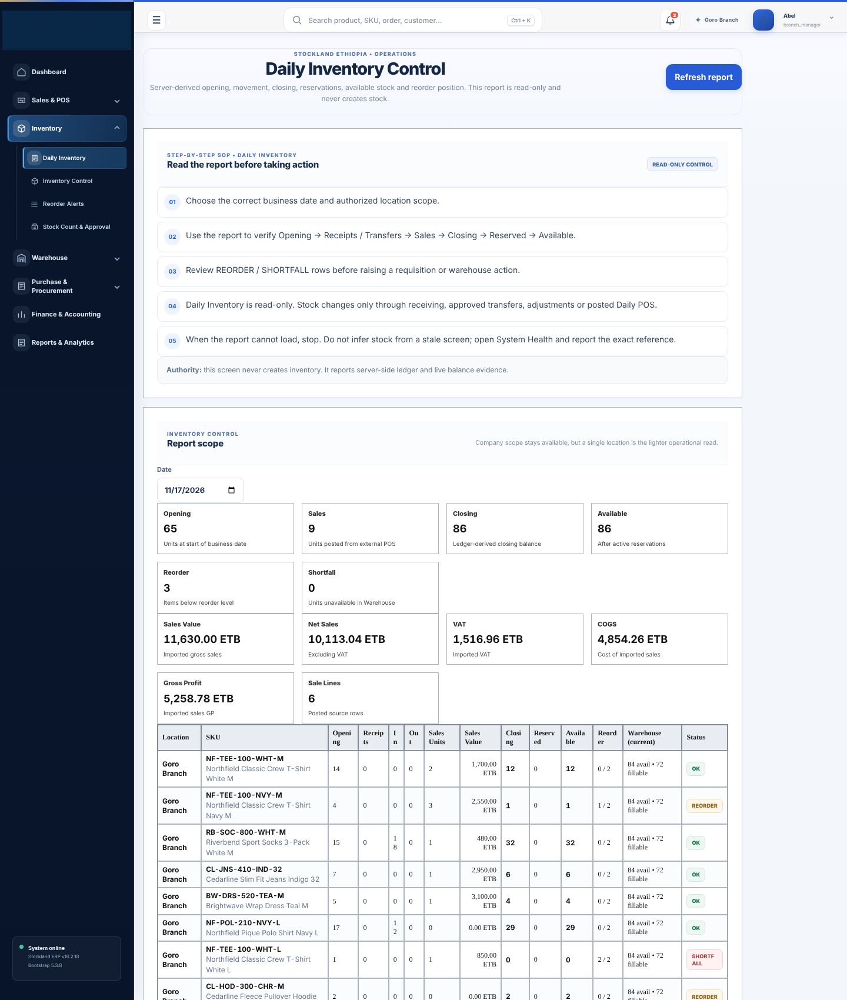
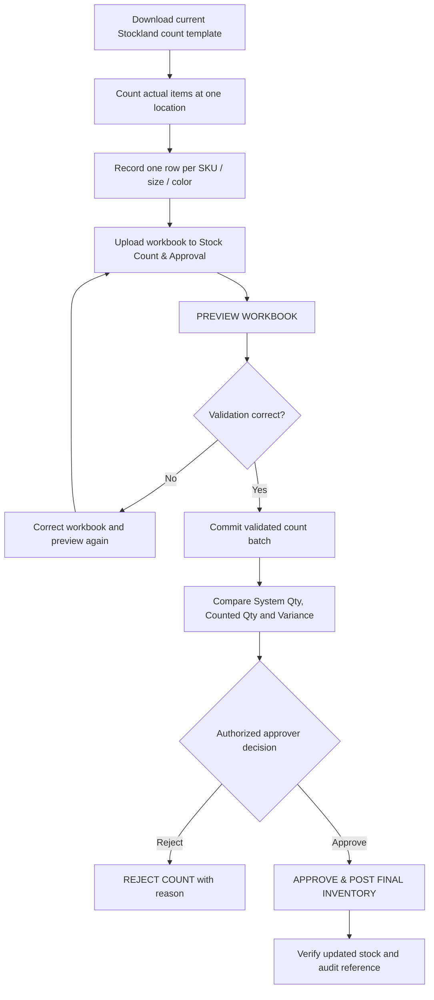
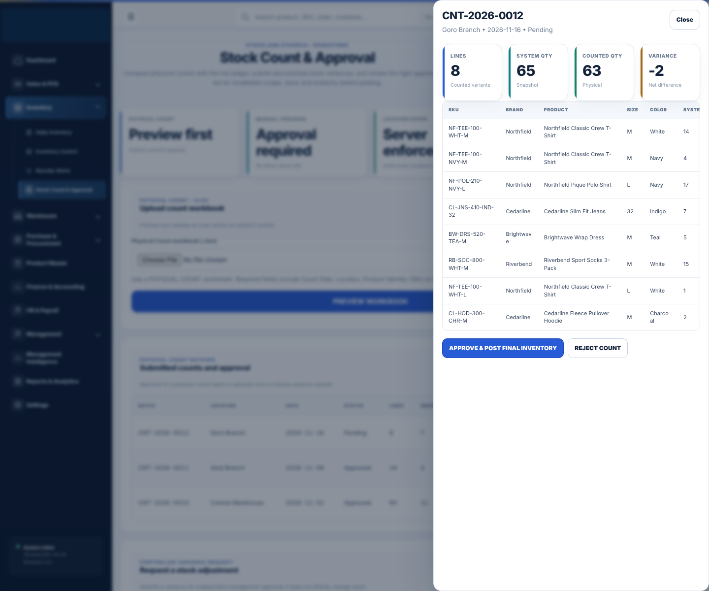

# 5. Inventory and physical counts

## Watch the walkthrough

_The animation demonstrates the controlled count sequence using sample values. A preview or committed batch is not a posted inventory correction; only the separate authorized approval action posts final inventory._

## Read current stock



### Open Inventory Control

Choose Inventory → Inventory Control.



### Search the item

Search by SKU, product, color, size, barcode or GTIN.

_Inventory Control searched for "NF-TEE-100": physical, reserved and available quantities per variant. Exact 16.2.18 front end, synthetic training data; quantities are not live stock._



### Read the location balance

Review physical, reserved and available quantities for each authorized location. This is a read-only view; do not type or manually override balances here.



## Daily Inventory report

Daily Inventory is a read-only ledger-derived report. Choose the business date and authorized location scope, then review:

1. Opening stock.
2. Receipts and transfers.
3. Sales.
4. Closing stock.
5. Reserved quantity.
6. Available quantity.
7. Reorder or shortfall indicators.

_Daily Inventory Control for a Branch Manager: date and location scope, then Opening, Sales, Closing and Available tiles. Exact 16.2.18 front end, synthetic training data._

If the report cannot load, stop and report the error. Do not estimate stock from an old screen or spreadsheet.

## Reorder Alerts

Use Reorder Alerts to identify items needing replenishment. Check branch/warehouse, SKU and availability before creating a requisition. An alert is a signal for review, not a stock transaction.

## Figure 1 — Physical count approval path

_Figure 1: previewing or committing a batch is not the same as posting final inventory. Only the authorized approval action completes the inventory correction._

## Physical count workbook

The ERP provides a Stockland Physical Count Excel template. Use the current template rather than inventing column headings. The workbook requires a PHYSICAL COUNT worksheet and, at minimum, count date, location, product identity (SKU or Brand + Product Name + Size + Color) and Quantity Found.



### Download the template

Use the template link provided in the ERP and save a working copy with the location and count date in its filename.



### Count physical stock

Count actual stock at the selected branch or warehouse. Record one row for each variant. Do not combine sizes or colors.



### Complete identity and quantity

Enter the SKU where known. If using descriptive identity, complete brand, product name, size and color. Enter the actual quantity found.



### Preview the workbook

Open Inventory → Stock Count & Approval, choose the XLSX workbook and select PREVIEW WORKBOOK. Review validation messages and detected location/date.

_Branch Manager workbook intake and approval workspace. Preview validates the workbook, and commit creates a batch for review. Only the separate authorized approval action posts final inventory._



### Commit the validated count

Use the commit action only after the preview is correct and the authorized user confirms the count. A preview does not post inventory.



### Review the batch

Open the created batch. Compare System Qty, Counted Qty and Variance for each SKU.



### Approver decision

The authorized approver can select APPROVE & POST FINAL INVENTORY or REJECT COUNT. Rejection requires a reason. Approval updates final inventory through the controlled workflow.

_Batch CNT-2026-0012 as an Owner sees it: System Qty, Counted Qty and Variance per SKU, with APPROVE & POST FINAL INVENTORY and REJECT COUNT. Exact 16.2.18 front end, synthetic training data; nothing was approved._



## Stock adjustment request

A manual variance request is not an immediate stock edit. Select the authorized location, live Product Master SKU, counted quantity and reason, then submit. It must pass the separate approval workflow before stock changes.


Never correct a difference by editing a database row, changing an old transaction or entering a fabricated receipt. Use the controlled count or adjustment workflow.

