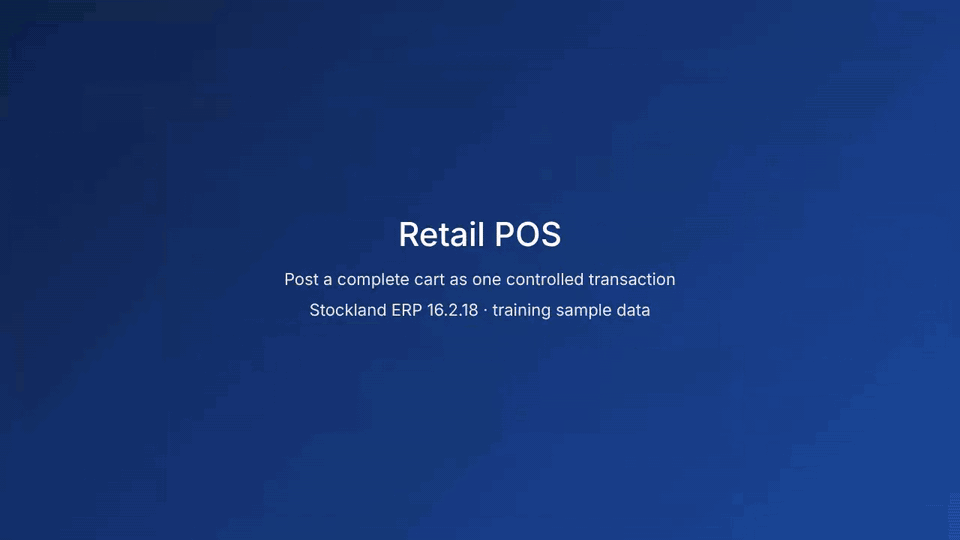
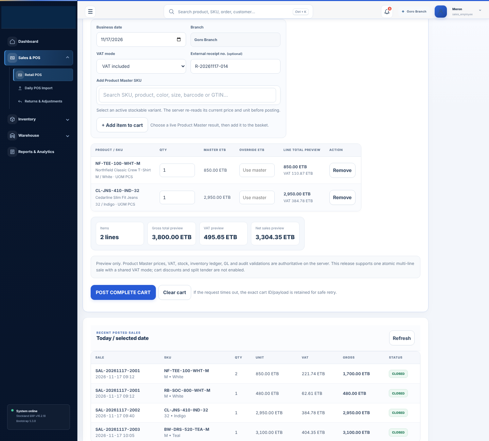
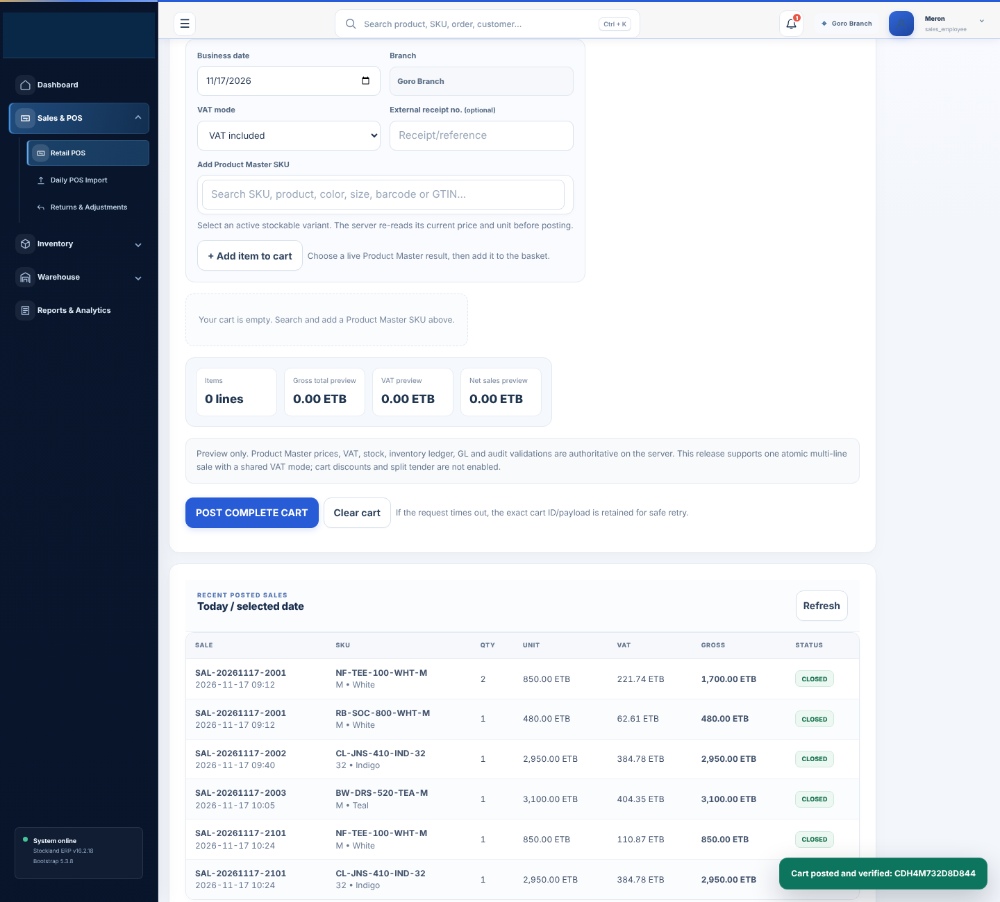
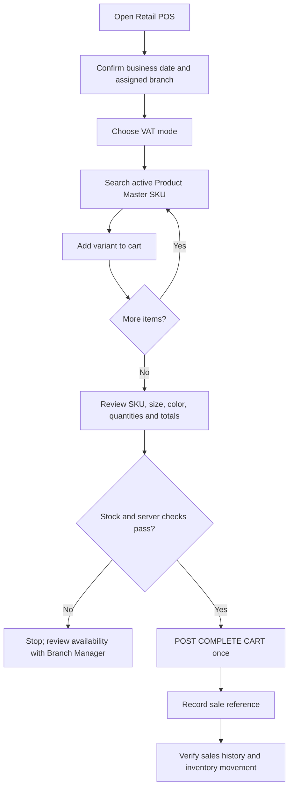

# 6. Retail POS

Retail POS is the direct Stockland ERP checkout. It posts a complete cart as one controlled transaction.

## Watch the walkthrough

_Sales Employee training walkthrough. The highlighted sequence uses training sample data and is not a real Stockland sale. In normal work, confirm branch, business date, SKU, quantity and totals; submit once, then verify the transaction before retrying._

## Before starting

* Posting is limited to authorized Sales Employees and Branch Managers.
* Confirm the correct branch and business date.
* Select an active stockable Product Master variant.
* Check stock availability.
* Do not use Daily POS Import for a sale already posted directly in ERP.

## Create a retail sale

_Capture note: use this image to recognize the screen and controls. Use the numbered steps below for the actual operating sequence; verify real branch, stock and sale details in the live system._



### Open Retail POS

Choose Sales & POS → Retail POS.



### Confirm the sale header

Check Business date, Branch, VAT mode and optional External receipt no. If only one branch is assigned, the branch may be read-only.



### Add the first item

Use Add Product Master SKU to search by SKU or product name. Select the correct active stockable variant, then click + Add item to cart.



### Add remaining items

Repeat the SKU search and add action. Verify product name, SKU, size, color and unit in the cart.



### Check quantities and totals

Review each quantity, master price, any permitted override and line total preview. Check Items, Gross total preview, VAT preview and Net sales preview.

_Sales Employee cart with two lines, the master price and line total for each, and the Items, Gross total, VAT and Net sales previews, with POST COMPLETE CART below. Exact 16.2.18 front end with synthetic training data._



### Post the complete cart

When all lines are correct, select POST COMPLETE CART once. Wait for the server response and sale reference.

_Sales Employee view after posting: the green confirmation shows the sale reference and the new sale appears in the day's list. Exact 16.2.18 front end; the reference and amounts are synthetic training data, not a live Stockland sale._



### Verify the result

Confirm the sale in authorized sales history and check the stock movement in Inventory. If the request times out, check the sale record before retrying.



## Figure 1 — Direct retail checkout

_Figure 1: direct Retail POS posts a complete cart. Do not also import the same sale through Daily POS Import. If the result is uncertain, check the existing transaction before retrying._

## VAT mode

The POS offers VAT included and Without VAT. The preview is not the final authority: Product Master price, VAT configuration, stock availability and ledger validation are checked by the server when posting.

## Insufficient stock

If available stock is insufficient, posting is blocked. Do not reduce the stock figure manually or choose another SKU without checking. Ask the Branch Manager to review stock or raise a requisition.

## Cart retry and duplicate protection

If the cart shows RETRY SAME CART, use it only to retry the same pending submission. Do not clear the cart or create a second sale while the result is uncertain. Verify the existing transaction first. The POS uses an idempotent cart submission pattern.

## Returns

Use Returns & Adjustments for a genuine return or correction. Do not reverse a completed sale by creating a negative sale or changing a posted ledger record.
