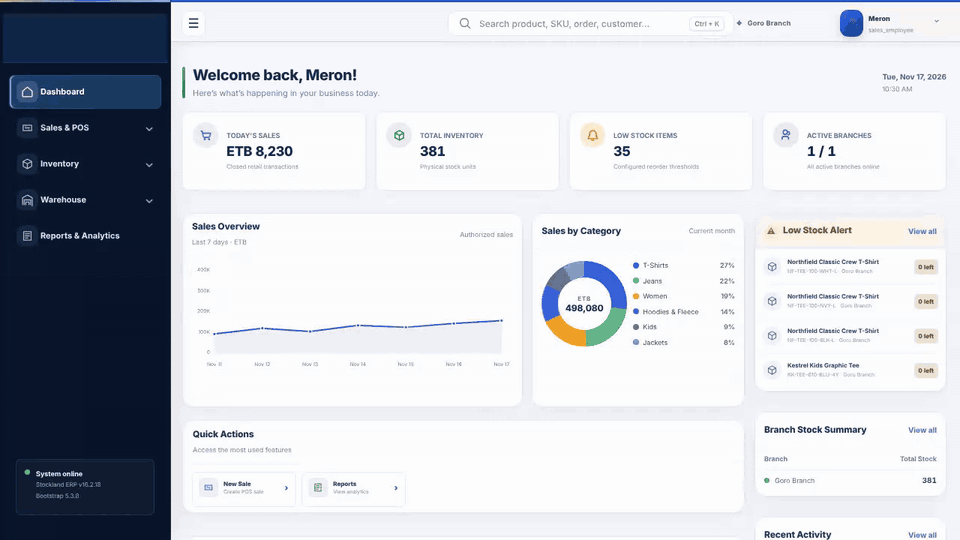
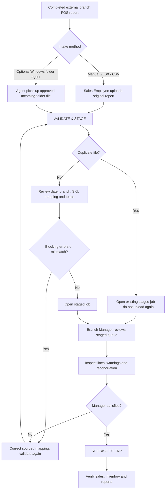
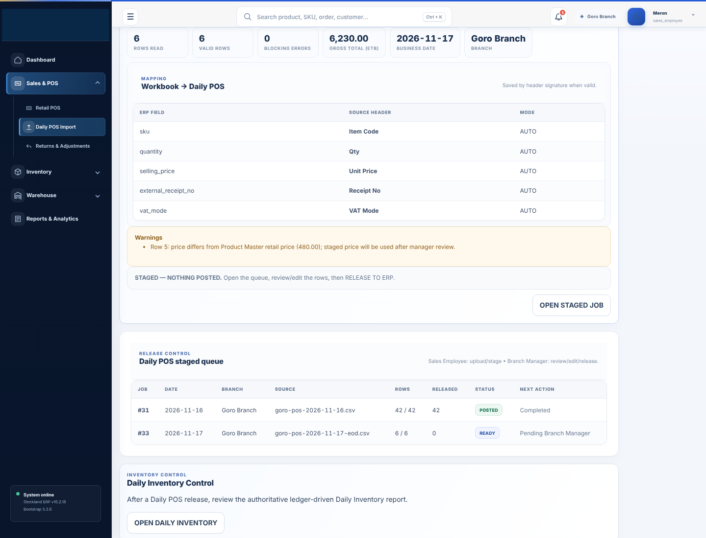
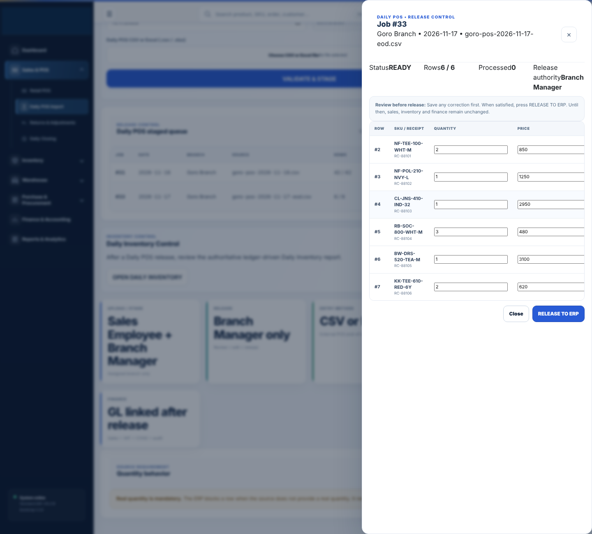
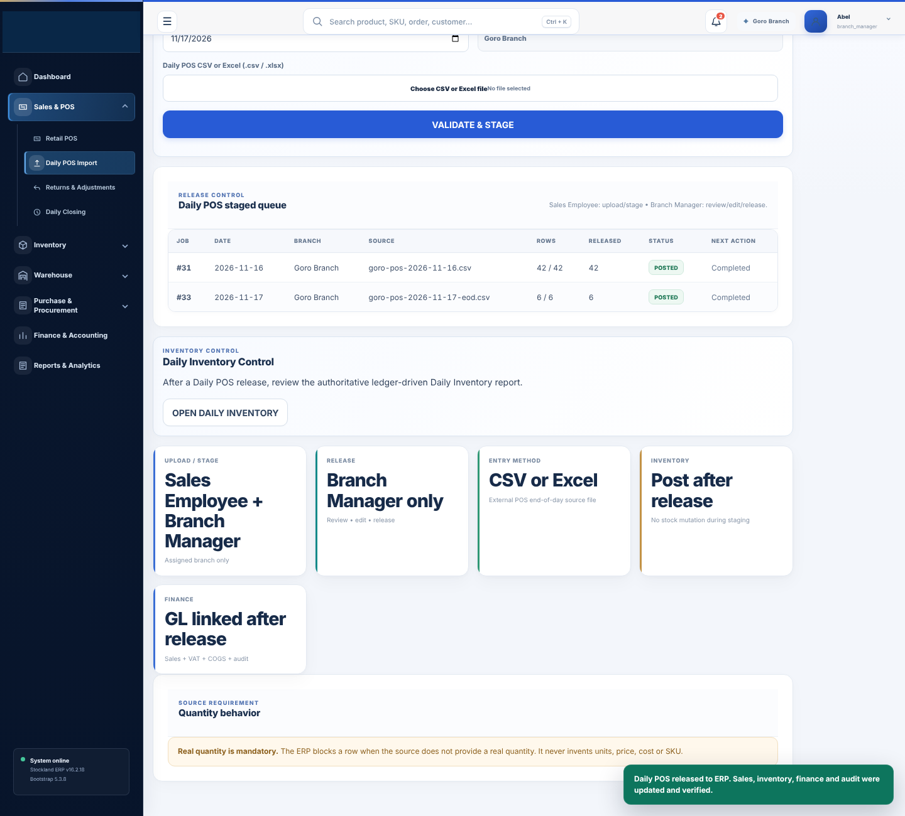

# 7. Daily POS Import

Daily POS Import reconciles completed sales from an external branch POS into Stockland ERP. It is separate from direct Retail POS checkout.

## Watch the walkthrough

_The animation follows the full path: Sales Employee upload and VALIDATE & STAGE, then Branch Manager review and RELEASE TO ERP. Values shown are training sample data._

## Intake options in 16.2.18

1. **Manual Excel / CSV upload** — supported in the application.
2. **Automatic folder pickup** — optional Windows branch-PC agent. It submits files into the same staging workflow and does not release sales.
3. **Future POS API** — reserved for a supplier's official authenticated API. No vendor API is connected in 16.2.18.

## Role responsibilities

* Sales Employee: upload and stage source evidence for the assigned branch.
* Branch Manager: review, edit, reconcile and RELEASE TO ERP.
* A staged import does not post sales, inventory or finance.

## Figure 1 — Daily POS import: staging is not release

_Figure 1: both supported intake methods feed the same staging queue. The Windows agent does not release sales. Only the Branch Manager review-and-release step posts the approved staged sales into ERP._

## Manual upload and staging

_Use this screen to locate the intake and staging controls. The steps below preserve the required validate-and-stage boundary; uploading does not approve or release sales._



### Open Daily POS Import

Choose Sales & POS → Daily POS Import. If the menu is hidden, your role or Daily POS capability may not be assigned.



### Select branch and business date

Confirm the assigned branch. Check the date detected from the source file. Enter a date only when the supported report does not provide one.



### Select the original report

Choose the original third-party POS Excel or CSV report (XLSX or CSV). Do not retype it into another template unless the approved source process requires it.



### Validate and stage

Select VALIDATE & STAGE. The ERP checks supported report dates, article/product codes, quantities, average amounts, line totals, VAT and report totals.



### Review the preview

_Sales Employee preview with synthetic training data. It illustrates validation and reconciliation only; it does not show a released import._

Check source format, business date, row summary, field mapping, source-to-ERP reconciliation, warnings and blocking errors. Correct the original workbook if there are blocking errors.



### Open the staged job

Select OPEN STAGED JOB and confirm the job number and status. If the ERP reports FILE ALREADY RECEIVED — NO DUPLICATE CREATED, open the existing job instead of uploading the same file again.



## Branch Manager review and release

_This is the Manager-side screen. The Manager checks the staged job and reconciliation before using RELEASE TO ERP; an uploaded or automatically collected file remains staged until that separate action._

The Branch Manager's review-and-release decision is a separate control from Sales Employee upload. Use the staged queue, inspect source totals and mapping, resolve exceptions, and select RELEASE TO ERP only after review.



### Open the staged queue

The Branch Manager opens the Daily POS staged queue for the assigned branch.



### Open and inspect the job

_Branch Manager review with synthetic training data. Inspect the staged job before releasing it._

Review source date, branch, rows, mappings, totals and warnings.



### Correct exceptions

Use available edit/review controls to resolve valid source differences. Do not force a release when source totals or SKU mapping are wrong.



### Release to ERP

Only after review is complete, use RELEASE TO ERP. This is the step that posts approved staged sales into ERP.

_Branch Manager post-release view with synthetic training data. It illustrates the final status after RELEASE TO ERP; verify the actual branch, date, sales and inventory result in the live system._



### Verify posting

Confirm final job status and check sales, inventory and reports for the same branch/date. Do not release the same report twice.



## Automatic folder pickup

The optional agent is a separate Windows component for an agreed branch-PC Incoming folder. It submits reports into the same validation/staging route. It stages only; it never performs the Branch Manager release decision. IT/Management must approve the branch-PC configuration.

## Common errors

* Duplicate file: open the existing job; do not upload again.
* Date missing/wrong: correct the source or enter the confirmed business date.
* Unknown article/SKU: ask Management to correct Product Master mapping.
* Source totals do not reconcile: investigate the original report; do not force release.
* Job staged but not released: Branch Manager review is still required.
