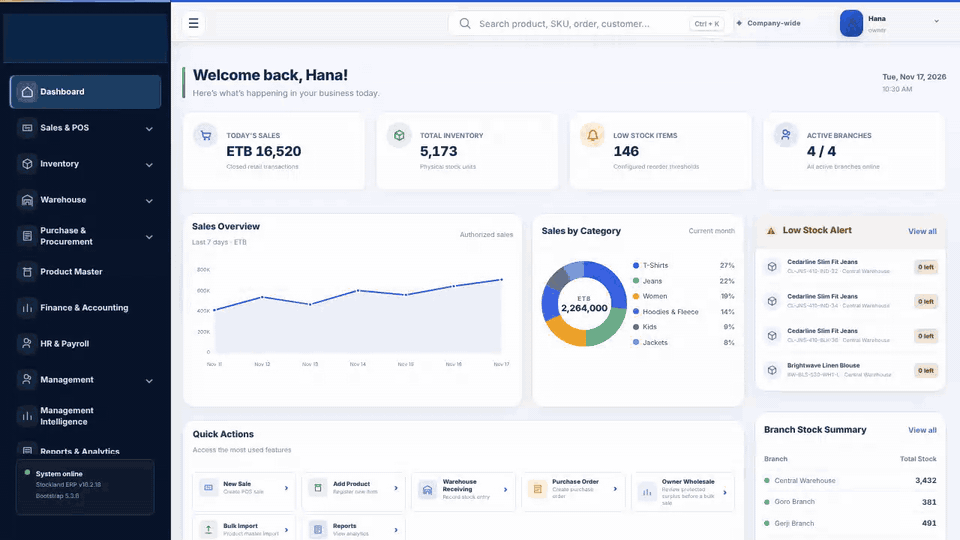
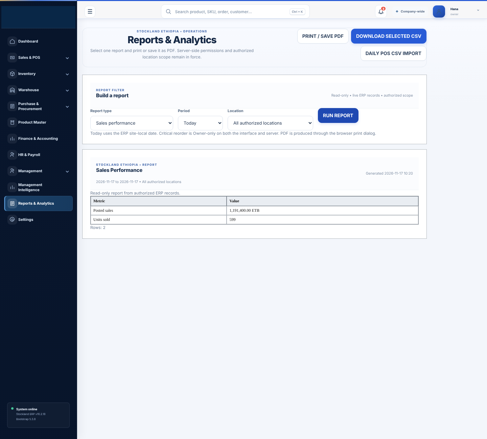
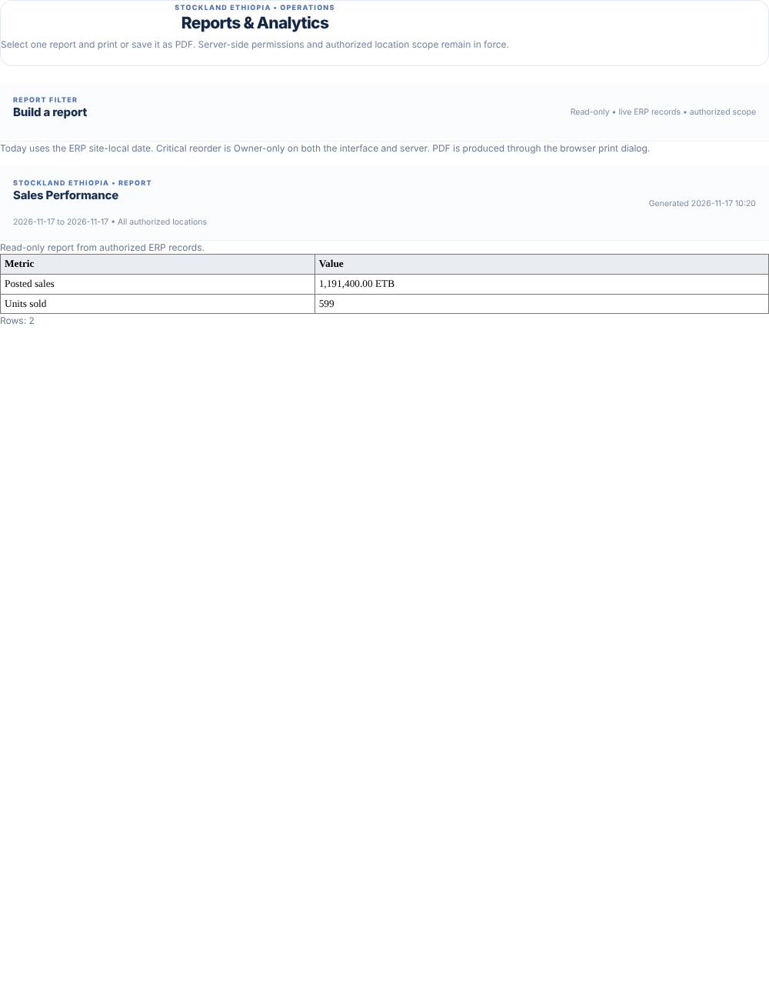
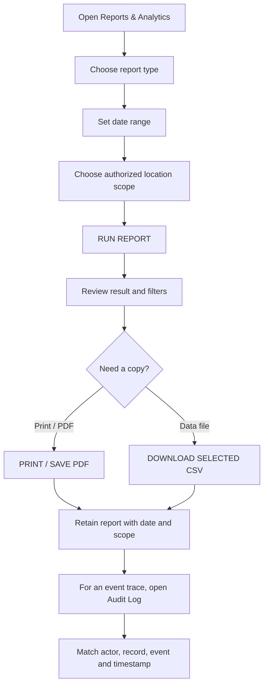

# 12. Reports and audit

## Watch the walkthrough

_Follow the highlighted sequence: choose the report type, date period and authorized location scope, run the report, print or export the selected result, then open Audit Log to trace the actor, record, event and timestamp. All displayed values are training samples._

## Build a report

### Screenshot — Auditor reports view in 16.2.18

_Exact 16.2.18 frontend capture under the Auditor capability profile. Sample fixture data only; this does not represent live financial or branch reporting data._



### Open Reports & Analytics

Choose Reports & Analytics from navigation.



### Select report type

Available report types include Branch performance, Sales performance, Product / SKU performance, Inventory availability, Transfer status, Transfer variance, Physical-count variance and Returns & adjustments summary. Critical reorder is Owner-only.



### Select the period

Choose Today, Yesterday, Last 7 days, This month or Custom range.



### Select location scope

Choose All authorized locations or a specific authorized branch/warehouse. The server enforces your access scope.



### Run the report

_Auditor report result with synthetic training data. It illustrates the selected filters and output, not live financial or branch reporting data._

Select RUN REPORT and wait for the live result.



### Print or export

_Auditor print-preview with synthetic training data. It illustrates the output format only._

Use PRINT / SAVE PDF for a printable report or DOWNLOAD SELECTED CSV for the selected report data, when enabled.



## Figure 1 — Report and audit review

### Screenshot — Auditor audit view in 16.2.18

_Exact 16.2.18 frontend capture under the Auditor capability profile. Sample fixture data only; this is not an audit export or a real production audit event._

_Figure 1: reports are read-only analysis. Audit Log is the trace of recorded events; neither is an edit path for correcting transactions._

## Daily Inventory versus Reports

Daily Inventory is a read-only ledger-derived stock movement view. Reports & Analytics is a report builder for performance, availability, transfers, counts and returns. Neither screen is a stock-entry function.

## Audit Log

Use Management → Audit Log when authorized. Inspect the relevant user, record and event. Use transaction reference and timestamp to trace what happened. An audit record is evidence, not an edit control.

## Reconciliation checklist

* Date and location match the intended business period.
* Report type matches the question being investigated.
* User has the correct authorized scope.
* Source documents and transaction references are retained.
* Differences are resolved through the proper workflow, not by editing history.
