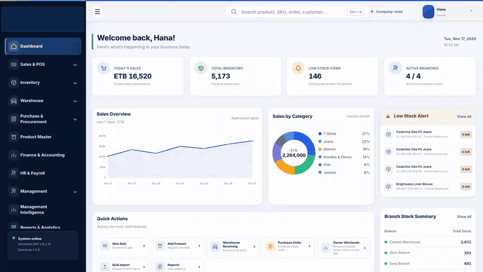
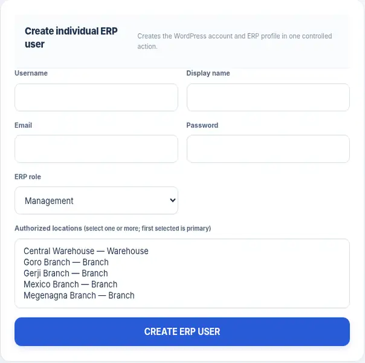
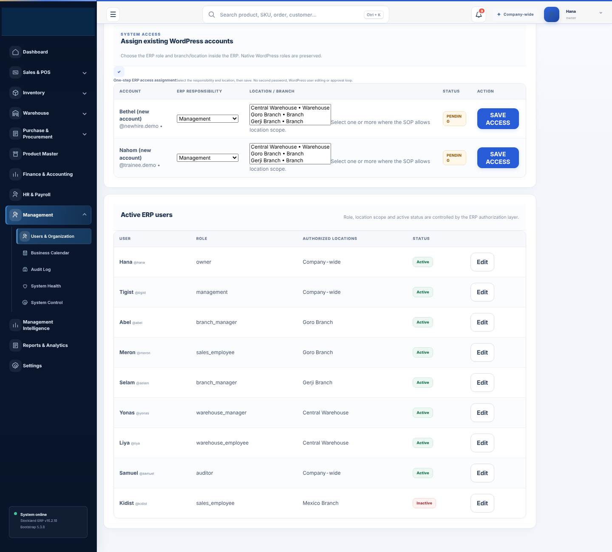
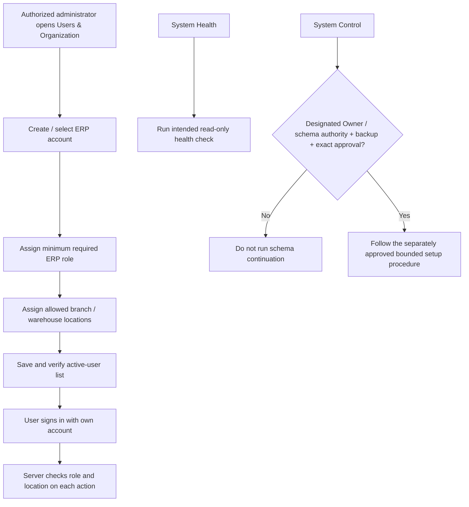
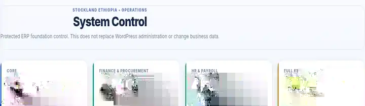

# 13. Users, settings and system control

## Watch the walkthrough

_The walkthrough shows where to review user roles and permitted locations, then where to find System Health and System Control. It is an orientation recording only: no account is created, no health check is run, and no schema action is executed. Displayed values are training samples, not live release evidence._

## Users & Organization

This is the ERP front-end access center. Authorized administrators can create ERP users, assign roles and set permitted locations.



### Open Users & Organization

Choose Management → Users & Organization.

### Screenshot — Owner navigation to access control

_This authentic 16.2.18 screenshot helps locate the Management navigation for an Owner account. Its values are synthetic QA fixtures._



### Create an ERP user

Where permitted, complete Username, Display name, Email, Password and ERP role.

_Illustrative capture of the exact 16.2.18 frontend with synthetic QA fixture data. The identity fields are blank. The Management role selector, location-list control and CREATE ERP USER button illustrate the form only. The button was not submitted; no account was created and no saved access assignment is evidenced by this image._



### Assign locations

Select the branch/warehouse locations the user may access. The first selected location becomes the primary location when the account is saved. Grant only the locations required for the user's duties.



### Create the user

Select CREATE ERP USER and verify the resulting account in the active-user list. Confirm the role and permitted locations against the employee's authorization before handing over access.



### Assign or reassign an existing account

Use the supported existing-account assignment area to attach or update the ERP role and permitted location scope. Confirm the saved result in the user list; do not assume an edit succeeded merely because the form was changed.



Only the Owner can assign the Owner role through the user-creation selector. Assign the minimum access required for the employee's work.

> **Remaining user evidence:** capture a completed create-user flow with privacy-safe training identity, the saved active-user row, and the separate existing-account role/location reassignment with its saved result. These are outcome screens; the inserted form capture does not prove either save occurred.

## Figure 1 — Access setup and protected system controls

_Figure 1: assigning a role or location is an access-control change. Health checks and protected schema operations have separate authority; ordinary ERP work does not require WordPress Dashboard access._

## Business Calendar and Settings

Business Calendar controls operating dates. Closed dates can block posting. Coordinate changes with Management.

System Settings includes central business identity, VAT rate/basis and branch/central reorder alert values. Only authorized users should change these values. Do not change tax settings based on an unverified assumption.

## System Health

System Health provides RUN QUICK HEALTH CHECK and RUN DEEP INTEGRITY AUDIT. The deep audit is read-only but can take longer on shared hosting. Run it intentionally during a quiet period and follow IT/Management instructions.

_Illustrative 16.2.18 frontend capture with synthetic QA fixture data. It shows the available actions only. No health check or deep audit was run for this image; it contains no returned PASS/FAIL result, timestamp or live environment evidence._

> **Actual result evidence still required:** capture the real RUN QUICK HEALTH CHECK result and the separate RUN DEEP INTEGRITY AUDIT result from the approved 16.2.18 environment. Show the returned status and time, while masking host paths, credentials, tokens and other infrastructure secrets. The action-panel image is not a result screenshot.


**Known issue for IT:** when the 16.2.18 front-end script was run in a standalone test copy with sample data, the health-check result view raised a JavaScript error (`quickOnly is not defined`). Confirm on the production site; if it reproduces, report it to the application maintainer before relying on the on-screen result.


## System Control

System Control is a protected ERP foundation page. It is not the normal business operations workspace and does not replace WordPress administration.

* It reports Core, Finance & Procurement, HR & Payroll and full-schema status.
* A protected setup continuation action is shown only to an authorized schema administrator.
* It advances bounded setup work and does not delete or reseed business records.
* Owner go-live authorization is tied to the release version and exact schema fingerprint.

_Illustrative 16.2.18 frontend capture using synthetic QA fixture values. The displayed 29/29, 16/16, 4/4 and 49/49 counts and LIVE label are sample values, not a production health check, live database read, release certification or proof of schema state. Do not use this image to approve or run a schema action._

Do not run schema actions unless you are the designated Owner/schema administrator and have completed the required backup and approval steps.

> **Actual status evidence still required:** capture the live System Control panel tied to the installed 16.2.18 release and its exact schema fingerprint. Mask sensitive fingerprints and technical secrets. Do not use a sample setup-action screenshot as production evidence.

## WordPress administration

Ordinary ERP users should work in the ERP front end. Native WordPress Dashboard remains a separate technical administration area for authorized site administrators.
