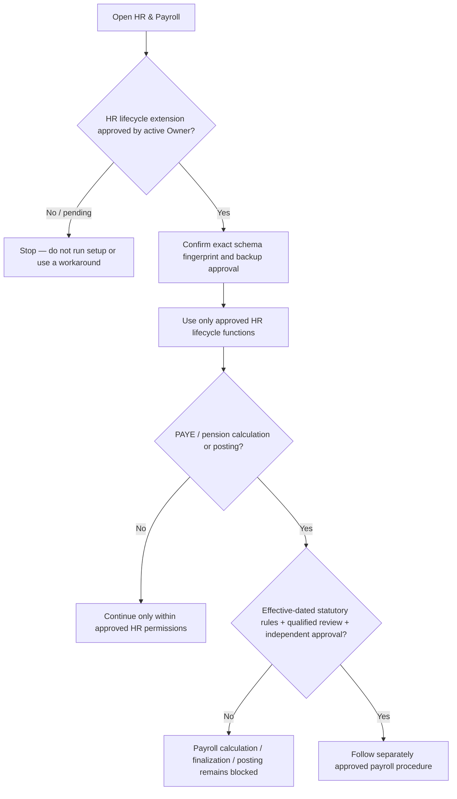
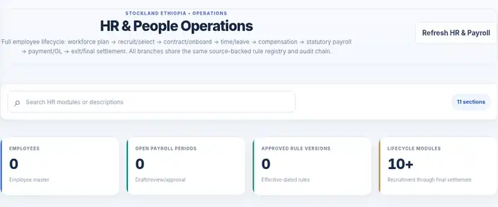

# 14. HR and payroll boundaries

The HR & Payroll menu exists in 16.2.18, but the full HR lifecycle is not automatically active merely because the operational installer is installed.

## Figure 1 — HR and payroll readiness gates

_Figure 1: installing the operational baseline does not automatically activate the separate HR lifecycle. This 16.2.18 release has no default current Ethiopian PAYE/pension schedule. Do not treat this diagram as authorization to calculate or post payroll._

## Setup boundary

The installer creates and verifies the 49-table operational baseline: 29 Core/Operations, 16 Accounting/Procurement and four legacy HR/payroll tables. The separate 37-table HR lifecycle extension and legacy-HR column migrations remain subject to explicit active-Owner approval against the exact schema version/fingerprint, backup confirmation and written reason.

If the HR page reports that lifecycle schema is pending, do not bypass the gate. Core, Inventory, POS and Finance/Procurement can be operational independently.

_Illustrative capture of the exact 16.2.18 frontend with synthetic QA fixture data. The displayed employee, payroll-period and approved-rule counts (including zero values), module count and section count are sample interface data. They do not establish that the HR lifecycle is active, that employee records exist, or that payroll rules have been approved. No employee or payroll transaction was performed._

## Payroll and statutory rules

The release does not ship a default current Ethiopian PAYE/pension rule schedule. PAYE/pension preview, payroll calculation, finalization and posting remain blocked until an effective-dated rule set is supported by exact official references, qualified Ethiopian payroll/legal review and independent approval.

* Do not calculate statutory deductions from old examples or historical constants.
* Do not treat a draft compensation record as approved.
* Approval requires explicit status, independent approver identity and genuine approval timestamp.
* Historical payroll records must not be silently recalculated.

## SOP documents

The release includes 24 Amharic-first DOCX SOP resources. They are marked DRAFT\_NOT\_APPROVED. File-integrity checks confirm file integrity only; they do not mean HR, Finance, legal or process owners have approved the procedure.

Use an SOP as an effective company policy, contract or statutory instruction only after the appropriate Stockland process owners formally approve it.

When an HR module is pending, unavailable or blocked, contact Owner/Management rather than attempting a workaround.

## Remaining HR, payroll and SOP evidence

The HR landing image above is interface-only evidence. The following outcome/status captures remain required if those states are actually exposed by the installed 16.2.18 application:

1. **HR lifecycle gate:** show the actual approval/setup state, if exposed. Do not imply that the separate lifecycle extension has been activated.
2. **Payroll statutory-rule gate:** show the actual effective-dated PAYE/pension rule readiness and approval status, if the application exposes it. Do not create sample deductions, payslips, payroll calculations or posting confirmations when no approved Ethiopian rule bundle exists.
3. **SOP library:** show the real document list and a safe preview with private employee information hidden; preserve the DRAFT\_NOT\_APPROVED status.

**Visual status:** one illustrative HR & People Operations landing screenshot is embedded. It is not an HR activation result. No live lifecycle approval, statutory payroll approval, payslip or SOP-library result is evidenced by the current image set.
