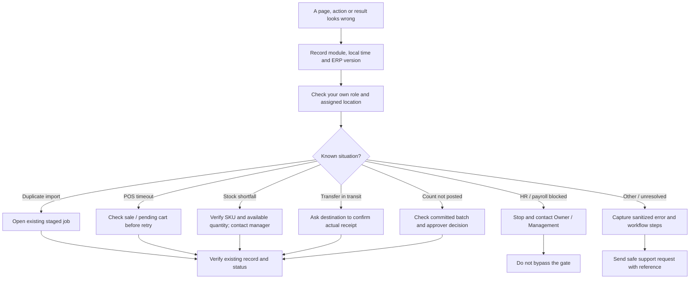

# 16. Troubleshooting

## Figure 1 — Safe issue triage

_Figure 1: confirm the existing record before retrying. Never bypass role, approval, stock, accounting or HR controls to make an error disappear._

## Device cannot connect to the ERP

1. Check that the device has an active internet connection.
2. Re-open the exact HTTPS production address supplied by Stockland Management.
3. Confirm that the address is not a development, preview or Cloudflare test address.
4. Reload once. If the page still does not open, stop and contact the authorized site administrator with the local time, device type, page address and a sanitized error screenshot.
5. Do not use a shared employee account, change browser values or switch to an unapproved URL as a workaround.

If the page opens but the module or action is unavailable, ask the administrator to verify the user's role, capability and assigned location. A PWA installation does not repair a server or permission problem.

## The ERP page does not open

1. Confirm that you are using the official production URL supplied by Stockland.
2. Confirm internet connection and HTTPS browser session.
3. Reload once.
4. If it still fails, contact the authorized site administrator with time, page address and a screenshot of the error. Do not substitute a development or preview address.

## A menu or button is missing

The menu may be hidden because your ERP role, capability or assigned location does not permit the action. Ask the administrator to review your role and location assignment. Do not use another employee's account.

## Product or SKU is not found

1. Search by exact SKU.
2. Try product name, style, brand, size, color, barcode or GTIN.
3. If it is not in Product Master, send verified details to Management/Owner for catalog review.
4. Do not create a duplicate SKU or use an unrelated variant.

## POS says stock is insufficient

Check selected branch, SKU and available quantity. Available stock is server-validated. Raise a requisition or ask the Branch Manager to investigate. Do not alter a balance manually.

## POS timed out or result is unclear

Do not immediately submit a second sale. Check sale history and pending cart state first. If the same cart is pending, follow RETRY SAME CART. Escalate if the sale reference cannot be confirmed.

## Daily POS file is reported as duplicate

Open the existing job shown by the ERP. Do not upload the same source file again. Review the existing job status and continue from there.

## Daily POS preview has errors or mismatched totals

Check original report date, branch, article/SKU mapping, quantities, line totals, VAT and source totals. Correct the source or mapping through the authorized process. A staged job with errors must not be released.

## Warehouse receipt is unavailable

Confirm the purchase order is approved and that the account is the authorized Warehouse Manager. Free-form manual receiving is not a supported stock-posting path in 16.2.18.

## Transfer is still In Transit

The destination branch must confirm actual receipt. Check transfer reference and notifications. Do not create a second transfer for the same shipment.

## Physical count is not posted

A preview does not update stock. Confirm the workbook was committed, the batch exists and the authorized approver completed the decision. Review batch status and variance.

## Report does not show a record

Check date range, location filter and your access scope. Reports are limited to records your account may view.

## HR or payroll action is blocked

Check whether the HR lifecycle extension is approved and ready. Statutory payroll processing also requires approved effective-dated Ethiopian rules and qualified review. Do not bypass the gate or use historical values as a substitute.

## Include this in a support request

* ERP version shown by the application.
* Date and local time.
* Module and page name.
* Transaction, requisition, transfer or job reference.
* Exact error text.
* Steps immediately before the error.
* Screenshot with personal information and secrets removed.

Never send passwords, API keys, private vault keys, personal employee documents or full customer data in a support message.
