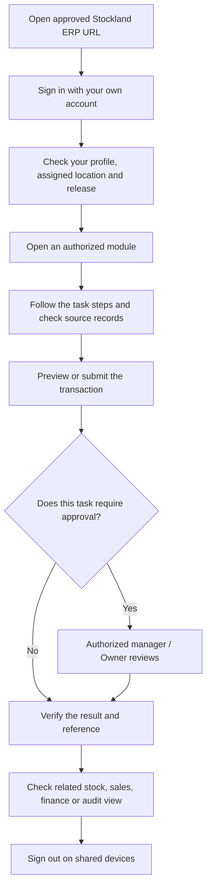

# Home

## Stockland Ethiopia ERP — User Manual

**Production reference:** Version 16.2.18\
**Company:** STOCKLAND ETHIOPIA\
**Audience:** Owner, Management, Branch Managers, Sales Employees, Warehouse Managers, Warehouse Employees, Finance users and Auditors.

This is the source-verified operating manual for Stockland Ethiopia ERP 16.2.18. Its steps and workflow figures are grounded in the 16.2.18 release source and the documented role and approval rules. It is not a generic ERP template and does not borrow screens or behavior from later development versions.

### Staff-training video draft

This draft follows the manual as a 17-chapter narrated staff-training program. Each chapter introduces the role, task, permission boundary, and verification point.

1. [01-getting-started.md](01-getting-started.md "mention") — access, sign-in, and safe shared-device use.
2. [02-roles-and-locations.md](02-roles-and-locations.md "mention") — assigned roles, branches, and permissions.
3. [03-command-center.md](03-command-center.md "mention") — navigation, status checks, and task handoffs.
4. [04-product-master.md](04-product-master.md "mention") — controlled catalog maintenance.
5. [05-inventory-and-counts.md](05-inventory-and-counts.md "mention") — counts, review, and approval.
6. [06-retail-pos.md](06-retail-pos.md "mention") — direct sales entry by Sales Employees.
7. [07-daily-pos-import.md](07-daily-pos-import.md "mention") — external file staging, review, and release.
8. [08-central-warehouse.md](08-central-warehouse.md "mention") — approved demand and PO-linked receiving.
9. [09-requisitions-and-transfers.md](09-requisitions-and-transfers.md "mention") — demand, picking, dispatch, and receipt.
10. [10-returns-and-adjustments.md](10-returns-and-adjustments.md "mention") — controlled corrections and approvals.
11. [11-finance-procurement-closing.md](11-finance-procurement-closing.md "mention") — purchasing, finance controls, and close.
12. [12-reports-and-audit.md](12-reports-and-audit.md "mention") — filters, output, audit detail, and print preview.
13. [13-users-settings-system-control.md](13-users-settings-system-control.md "mention") — Owner-only administration and health context.
14. [14-hr-payroll.md](14-hr-payroll.md "mention") — readiness gates and restricted work.
15. [15-screenshot-capture-checklist.md](15-screenshot-capture-checklist.md "mention") — evidence requirements and outstanding captures.
16. [16-troubleshooting.md](16-troubleshooting.md "mention") — safe diagnosis and escalation.
17. [17.-gitbook-ask-and-mcp-maintainer-workflow.md](17.-gitbook-ask-and-mcp-maintainer-workflow.md "mention") — maintainer-only documentation operations.


Review this rendered training draft before publication. Narration, graphics, and walkthrough GIFs support learning. They do not prove production activity, approvals, system health, or saved outcomes.


#### Connection guidance

Use a supported desktop browser for administration, warehouse, finance, and reporting tasks. Use a managed mobile device only for workflows exposed to that device and role. Use a supported POS workstation for Retail POS and its assigned branch.

Keep the operating system, browser, network, and endpoint protection current. Use only the approved ERP address. Do not share accounts or bypass assigned locations. Sign out after using a shared workstation.

#### External POS import and permissions

Retail POS and Daily POS Import are separate workflows. Sales Employees record direct sales through Retail POS. Sales Employees may upload and stage assigned-branch external POS files. Branch Managers review, edit, and release staged Daily POS Import jobs.

An upload or staged job does not post a transaction. The release does not connect a supplier POS API. Optional folder pickup runs separately on an approved Windows branch PC. Visible controls never override server-side authorization.

#### Training visuals and restricted topics

The program retains 11 chapter-linked walkthrough GIFs. They are illustrative training graphics, not production evidence or live recordings. Retain their captions and surrounding caution text with each placement.

HR and payroll stay separately gated. Do not show payroll calculations, posting, or statutory outcomes without approved prerequisites. GitBook and MCP maintenance remain maintainer-only. They are outside ordinary ERP operating roles.

### Visual guide

The manual uses a simple two-color reading system:

| Marker                    | Meaning                                                         |
| ------------------------- | --------------------------------------------------------------- |
| 🔵 **Blue — guidance**    | Normal navigation, explanations and routine operating steps     |
| 🟠 **Orange — attention** | Important checks, approval points and actions that require care |

Blue is the primary reading color; orange is reserved for meaningful action and caution cues. The cover artwork follows the same palette.

### Figure 1 — The normal operating journey

_Figure 1 is a workflow map, not a captured application screenshot. The following pages contain numbered step-by-step instructions and role-specific controls._

### Read this first

* Use the menus and buttons visible to your signed-in account. Access depends on ERP role, assigned location and server-side permissions.
* A visible button does not override the server's authorization check.
* Never enter invented stock, customer, supplier, price, tax, payroll or accounting values.
* A preview, upload or staged job is not the same as a posted transaction.
* Do not repeat a transaction because a screen appears slow. Check its queue or history first.
* Ordinary users work in the ERP front end. WordPress administration remains a separate technical area for authorized administrators.

### Important 16.2.18 boundaries

The operational baseline covers Command Center, Retail POS, Product Master, inventory, Central Warehouse, requisitions, transfers, returns and adjustments, physical counts, procurement, suppliers and customers, AP/AR, expenses, general ledger, daily close, reports, audit and access management.

Some functions have separate approval/readiness gates:

* **Daily POS Import:** Sales Employees upload and stage assigned-branch source files. Branch Managers review, edit and release them to ERP. Optional folder pickup is a separate Windows branch-PC component. A supplier POS API is not connected in this release.
* **Product Master bulk import:** Management/Owner only. It updates catalog data; it does not create stock.
* **Goods receiving:** PO-linked. Receive only against an approved purchase order and its lines. Free-form manual receipts do not post inventory.
* **HR lifecycle and payroll:** the 37-table HR lifecycle extension is separately Owner-gated. Current Ethiopian PAYE/pension calculations, payroll finalization and posting require an approved effective-dated statutory rule set.
* **Embedded SOP files:** 24 Amharic-first SOP documents are drafts. File integrity is not process-owner approval.

### Start here

1. [Getting started](01-getting-started.md)
2. [Roles and locations](02-roles-and-locations.md)
3. [Command Center](03-command-center.md)
4. Select the page for your task from the navigation.

### Evidence and screenshots

The numbered instructions and Mermaid figures are source-based workflow illustrations. They are not screenshots of the live website. An authenticated production browser session was not available during this documentation pass, and no genuine application screenshots were found in the documentation, delivery or release-certificate branches. The [Screenshot capture checklist](15-screenshot-capture-checklist.md) lists the real screens still to capture from the installed 16.2.18 application. Do not mistake the Stockland logo, app icons, backgrounds or cover artwork for application screenshots.

### Release identity

* Release: 16.2.18 (`MASTER_INSTALLER` in the release manifest)
* Canonical installer source commit recorded in `RELEASE_MANIFEST.json`: `2b4bcca9bb8205e69224e0886f869a4069424f53`
* Documentation branch: `docs/stockland-erp-user-manual-16.2.18`
* GitBook-synced project directory: `docs/user-manual-16.2.18/documentation/`

This documentation is isolated on a documentation branch. It does not modify the production application, installer or certified release branch.
