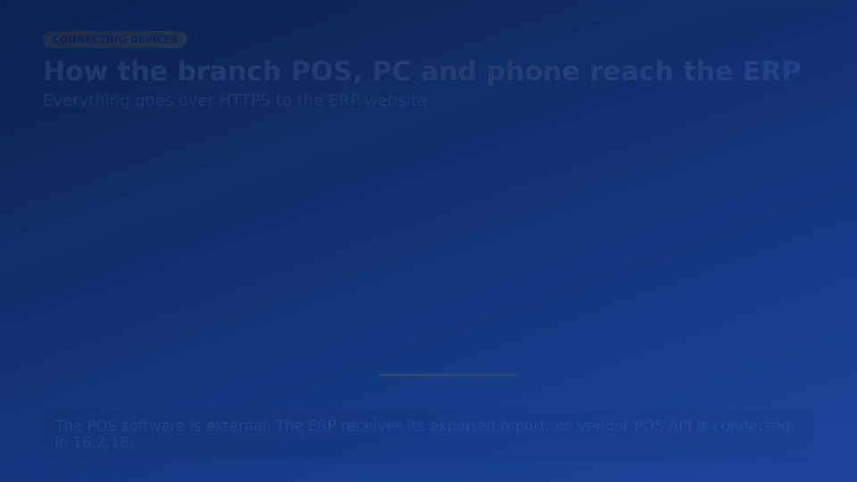
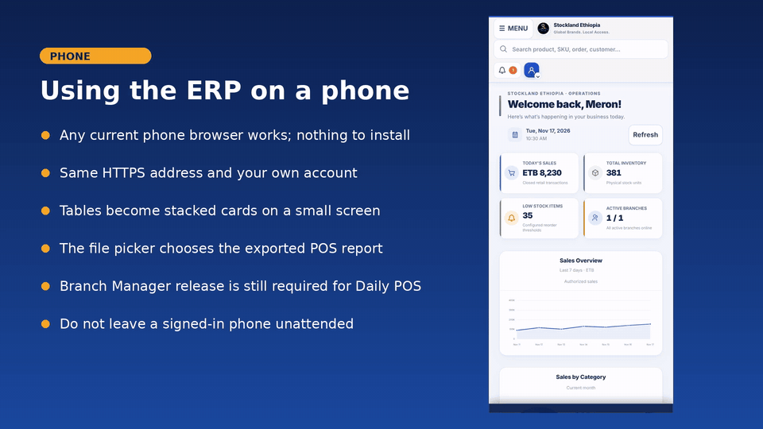

# Connecting the POS, Windows PC and phone

Stockland ERP is a website. Staff use it from a browser on a Windows PC or a phone. The branch POS machine and its software are **external**: the ERP receives the report that software exports. This page shows exactly what is supported in 16.2.18.

## Watch the walkthrough





## Connection options

| Device                       | How it connects                                                                                | Who uses it                                              |
| ---------------------------- | ---------------------------------------------------------------------------------------------- | -------------------------------------------------------- |
| Windows PC                   | Browser to the official HTTPS ERP address; manual upload of the POS export                     | Any signed-in user                                       |
| Windows PC, optional agent   | Scheduled PowerShell 7 task submits files from an Incoming folder to the same staging workflow | Branch PC, set up by IT with Management approval         |
| Phone                        | Same HTTPS address in the phone browser; tables become stacked cards                           | Sales Employee, Branch Manager, others by role           |
| POS machine and POS software | Exports an XLSX or CSV day report; nothing connects directly to the ERP                        | Cashier or Sales Employee exports, Sales Employee stages |
| Vendor POS API               | **Not connected in 16.2.18**                                                                   | Reserved for a future, approved supplier API             |

## Windows PC or phone: manual upload



### Open the official address

Use the HTTPS address Stockland gives you. Never use a development or preview address. Sign in with your own account.



### Export from the POS software

At close of business export the day report as XLSX or CSV. Keep the original unchanged. The supported source is the CNET Cash Sales Voucher report summarised by article, plus common mapped CSV or XLSX exports.



### Stage it in the ERP

Choose Sales & POS, then Daily POS Import, pick the file and select VALIDATE & STAGE. The branch comes from your account and the date from the report. Staging never posts sales.



### Branch Manager releases

The Branch Manager reviews the staged job and uses RELEASE TO ERP. See [Critical imports in depth](critical-imports-in-depth.md).



## Optional: Windows folder agent

The agent watches a local Incoming folder and sends each XLSX or CSV to the same staging endpoint as the manual upload. It never releases sales, reduces stock or creates journals. It is a branch-PC agent, not a server job, and needs an interactive Windows session.



### Prepare

Install PowerShell 7.4 or later. In the ERP create a dedicated **Sales Employee** account assigned to exactly one branch, with no release authority, and create a WordPress Application Password for it. Do not use an Owner or Branch Manager login.



### Install

In PowerShell 7, from the agent folder, run:

```powershell
Set-ExecutionPolicy -Scope CurrentUser RemoteSigned
.\Install-StocklandPosFolderAgent.ps1 -SiteUrl "https://YOUR-ERP-DOMAIN"
```

Enter the branch account name and Application Password when asked. The installer stores the password protected by Windows DPAPI and creates a Task Scheduler task that runs every minute as the signed-in user.



### Drop the report in Incoming

Put the original POS export into `%LOCALAPPDATA%\StocklandPOS\Incoming`. The agent waits 5 seconds after the last write, then uploads it.



### Read the result folder

* **Submitted**: accepted; a staged job exists or already existed.
* **NeedsReview**: staged as REVIEW; the Branch Manager reconciles it.
* **NeedsAttention**: a permanent 4xx error (account, scope, size, date, closed day or validation); read `%LOCALAPPDATA%\StocklandPOS\agent.log`.
* **Incoming**: a network or server error; the file stays and retries next minute.



### Branch Manager releases

The staged job still needs the normal RELEASE TO ERP.



## Scanners and printers

* **Barcode scanner:** search boxes accept typed text, so a scanner that types like a keyboard can fill them. Test your model before relying on it.
* **Printing:** reports use the browser's PRINT / SAVE PDF, so any printer or PDF printer installed on the PC works.
* **Not built in 16.2.18:** cash-drawer or thermal-printer drivers, USB or Bluetooth device access, and a direct POS vendor API.

## Limits and safety

* HTTPS is mandatory. The agent limits files to 15 MB; the ERP is the final validator.
* Keep the PC signed in and online for the agent. It is not a hosted background service.
* Never edit or rename a report to force acceptance.
* Never send passwords or Application Passwords in a support message.
