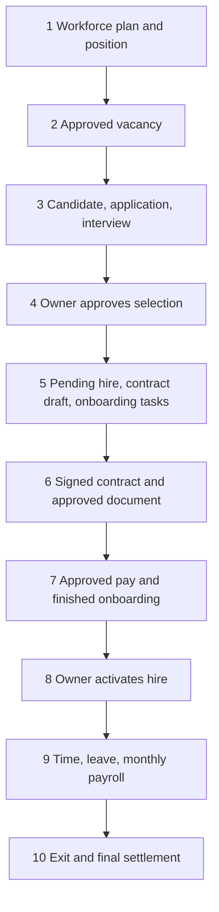
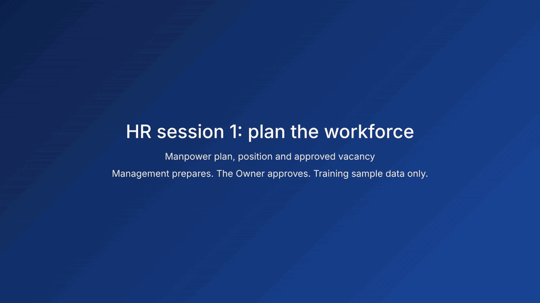
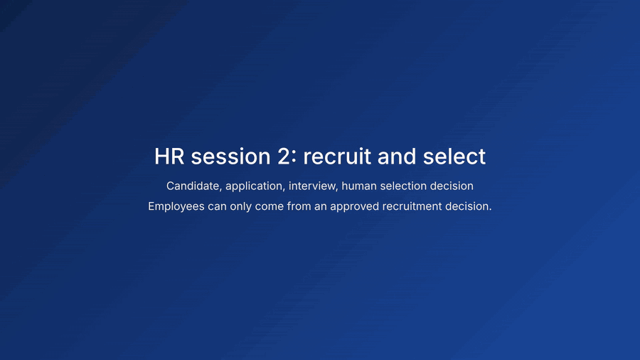
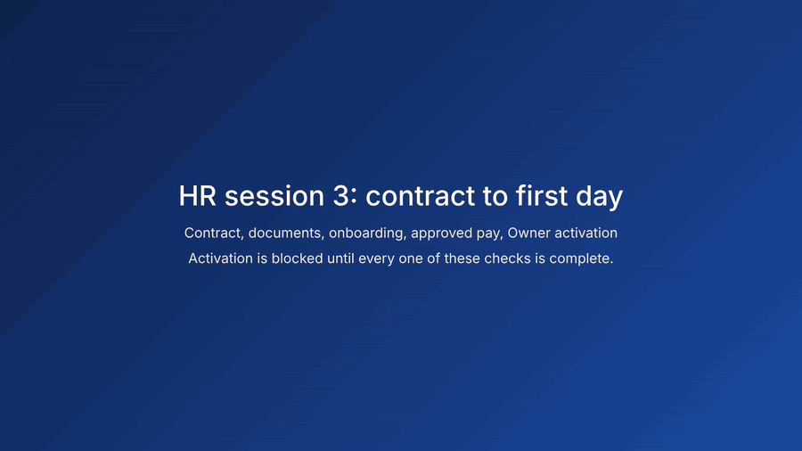
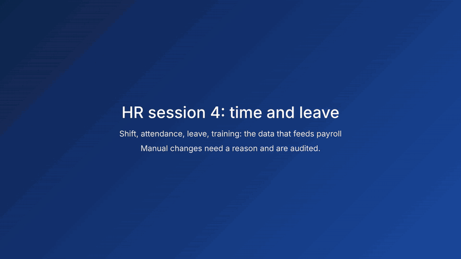
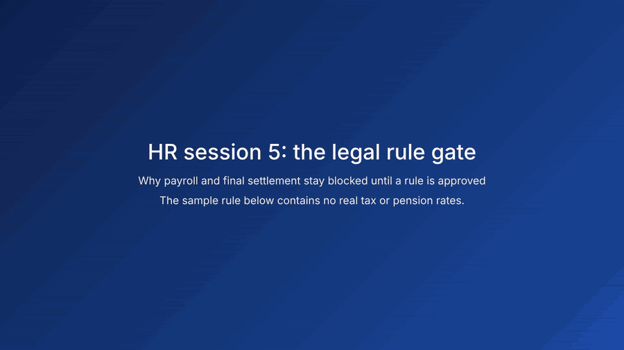
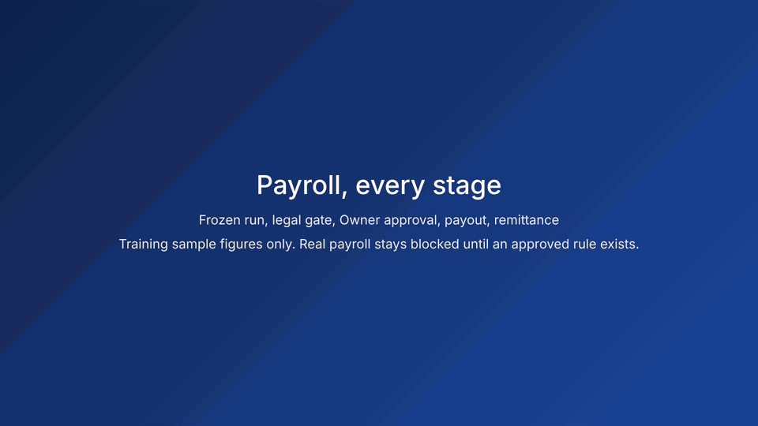
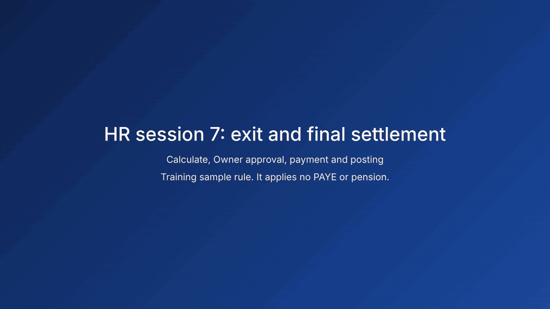

# HR and payroll: full session, plan to final settlement

This chapter follows one employee from the first headcount plan to the final settlement payment. Every session is an animation of the real 16.2.18 screens. Nothing is skipped: each approval, each separate person and each place where the ERP refuses to continue is shown.


**What the evidence is.** All screens use synthetic training data (Training Candidate D, sample codes, sample amounts). They are not captures from a production database. The sample rule used in the animations applies **no PAYE and no pension rates**. Never copy a figure from these animations. Your tax, pension, leave and settlement values must come from an officially sourced rule that your payroll or legal reviewer has approved.


## Watch the whole session as one video

The full HR and payroll training video (about 10 minutes, 1080p) covers sessions 1 to 8 in order.


HR and payroll full session, plan to final settlement


## Who does what

The ERP separates the person who prepares from the person who approves. A preparer can never approve their own record.

| Step                              | Management prepares                                                     | Owner decides                               |
| --------------------------------- | ----------------------------------------------------------------------- | ------------------------------------------- |
| Workforce plan, position, vacancy | Create and submit                                                       | Approve                                     |
| Selection                         | Register candidate, link, record interview, submit for selection review | Approve selection, then Create pending hire |
| Contract and documents            | Create, register signed contract                                        | Approve document, approve contract          |
| Pay (compensation)                | Prepare and preview                                                     | Approve with a written rationale            |
| Activate hire                     |                                                                         | Activate verified hire                      |
| Statutory rule                    | Create DRAFT                                                            | Independent review and approval             |
| Payroll run                       | Create draft, generate, submit                                          | Approve and post                            |
| Final settlement                  | Calculate from approved rules                                           | Approve, then record payment                |

## The lifecycle at a glance

## Session 1. Plan the workforce and open the vacancy



### Create the manpower plan

Open HR & Payroll, then 1 · Workforce planning, then Create manpower plan. Enter plan code, fiscal year, department, planned headcount, annual salary budget and the business justification. Save. The plan is a DRAFT.



### Submit, then Owner approves

Management selects Submit. The Owner opens the same list and selects Approve. Only an approved plan supports a position.



### Create and approve the position

Create position with code, title, department, grade, location, headcount slots and salary band, linked to the plan. Submit it. The Owner approves it.



### Open the vacancy

In 2 · Recruitment and selection, use Open approved vacancy. Link the position and plan, set openings, employment type and target start date. Submit. The Owner approves. Recruitment may now start.



## Session 2. Recruit and select



### Register the candidate

Enter the candidate code, name, contact details, source and the consent date.



### Link the candidate to the vacancy

Choose the vacancy and candidate, the stage and a screening score. The application starts as PENDING.



### Record the interview

Record the panel, scorecard, total score and recommendation. The ERP will not allow selection without at least one completed interview recommendation.



### Submit, approve, create the pending hire

Management submits the application for selection review. The Owner approves the selection, then selects Create pending hire and writes the selection rationale (at least 20 characters). The ERP creates a PENDING employee, a contract draft and four onboarding tasks.




A PENDING employee cannot work, clock time or be paid. Direct employee creation is disabled on purpose.


## Session 3. Contract, documents, onboarding, pay and activation



### Register the contract document

In 3 · Contracts, personnel documents and onboarding, register a personnel document of subject CONTRACT and type EMPLOYMENT\_CONTRACT. Only the reference is stored. Submit it. The Owner approves it.



### Register the signed contract

On the contract draft, select Register signed contract. The ERP asks for the approved document ID and the signature date. After a successful save the contract moves to SUBMITTED and the Owner approves it.



### Complete the four onboarding tasks

CONTRACT\_SIGN, PERSONNEL\_DOCS, PAYROLL\_SETUP and INDUCTION must all be COMPLETE.



### Prepare and approve the starting pay

In 5 · Compensation, enter employee, effective date, base salary, pensionable salary and allowance rows. Use Preview legal allowance split: with no approved allowance rule, every allowance stays fully taxable. Save the draft. The Owner approves it with a written rationale.



### Activate the hire

The Owner selects Activate verified hire. The ERP re-checks the approved contract and document, the finished checklist and the approved pay. Only then is the employee ACTIVE.




**Known issue in 16.2.18 (report to the maintainer).** When the training script ran the real 16.2.18 front end, Register signed contract saved nothing. Its input check is written with a doubled backslash, so every document ID and every date is rejected silently and the contract stays DRAFT. Because the contract cannot reach approval, hire activation is blocked from this screen. Do not work around it by typing values elsewhere; ask the maintainer for a fix or an approved procedure. The animation shows the failure, then continues with the intended result so you can see the remaining steps.


## Session 4. Time, leave and training



### Create the shift

Shift code, name, location, start and end time, break and effective date.



### Record attendance

A manual entry needs a correction reason. Approved time data feeds payroll.



### Propose the leave policy

Entitlement, carry-over and notice days must follow your approved rule. The sample value in the animation is not a recommendation.



### Submit and approve leave

Submit the request. An approver decides. The leave balance changes only after approval.



Stage 8 (training, performance and employee changes) uses the same draft, submit and approve pattern.

## Session 5. The legal rule gate



### Create the rule draft

In 6 · Statutory rule register enter rule type, version, jurisdiction, effective dates, official source title, official HTTPS source URL, clause, the SHA-256 of the source document, and the rule JSON. A DRAFT rule does nothing.



### Independent approval

The person who created a rule can never approve it. The Owner approves with an independent review note of at least 30 characters, and the rule must carry qualified legal review evidence. A payroll rule must include tax bands ending in an open band, employee and employer pension rates and a tax-base method. A final-settlement rule must include component rules. An approved rule of the same type cannot overlap in dates.



### See the block

Without an approved rule the payroll run cannot be generated and the ERP says: "No independently reviewed rule bundle is approved for this exact pay period. Payroll is blocked."




**Gap in 16.2.18.** The Statutory rule register screen lets you create a rule draft but shows no list of rules and no Approve button, so the independent approval is an Owner action outside this page. Confirm the approved procedure with the maintainer before go-live.


## Session 6. The payroll month

The full payroll stages (frozen run, legal gate, Owner approval and posting, recipient payout batch, statutory remittance, reconciliation) are in [HR and payroll, stage by stage](hr-and-payroll-stage-by-stage.md), including the known payout-result issue.

## Session 7. Exit and final settlement



### Enter the exit

In 9 · Exit and final settlement choose the employee, exit type (resignation, termination, retirement, redundancy, contract end or other approved exit), exit date, last work date, the approved reason with evidence, and each settlement line with category, amount, legal basis and source reference. Add lawful deductions if any.



### Calculate

Select Calculate from approved rules. Without an Owner-approved final-settlement rule that covers the exit date the ERP refuses: "No Owner-approved final-settlement legal ruleset covers the exit date. Settlement cannot be calculated." With one, a CALCULATED draft appears showing gross, net and the rule version.



### Owner approves

The Owner verifies the legal rule, leave balance, final pay, deductions and gross-to-net reconciliation, writes a review note of at least 20 characters and approves. The preparer cannot approve their own settlement.



### Record payment and post

The Owner selects Record payment + post and enters the bank, cash or cheque reference. The ERP posts the settlement journal. Approval and payment are separate steps on purpose.



## Session 8. Close the month

Reconcile the payout batch to the bank statement and each statutory remittance to its filing or payment reference, as shown in Session 6. Keep the review notes: the ERP records who approved what and when.

## What the ERP will refuse

| You try                                      | The ERP says                                                                                        |
| -------------------------------------------- | --------------------------------------------------------------------------------------------------- |
| Select a candidate with no interview         | At least one completed interview panel recommendation is required before selection.                 |
| Activate without a signed, approved contract | A signed and Owner-approved employment contract is required before activation.                      |
| Activate with open onboarding tasks          | Complete the contract, personnel-document, payroll-setup and induction checklist before activation. |
| Activate without approved pay                | An authorized, effective-dated and approved compensation record is required before activation.      |
| Approve your own rule                        | Maker-checker control: the rule creator cannot approve their own rule.                              |
| Approve your own settlement                  | Maker-checker: settlement preparer cannot approve the settlement.                                   |
| Pay an unapproved settlement                 | Only an approved settlement can be paid.                                                            |

## Trainer checklist

* Use two accounts: one Management, one Owner. Never demonstrate approval with the preparer's account.
* Use training records only, never a real employee, on a training site.
* After each session ask the trainee to point to the record in its new state.
* Do not enter any tax, pension, leave or settlement value that has not been reviewed from an official source.
