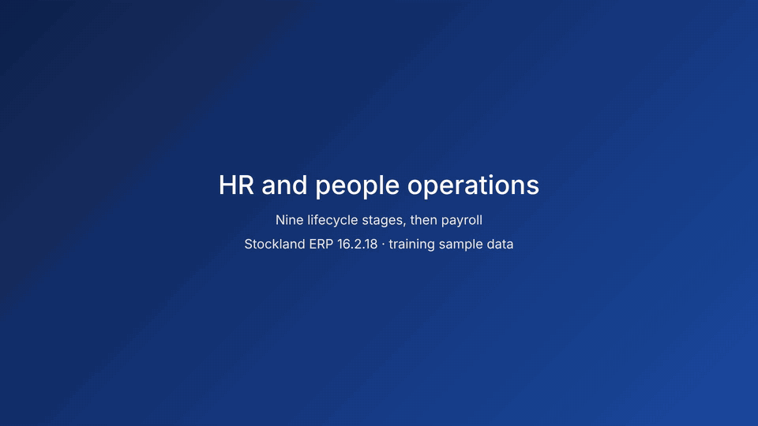
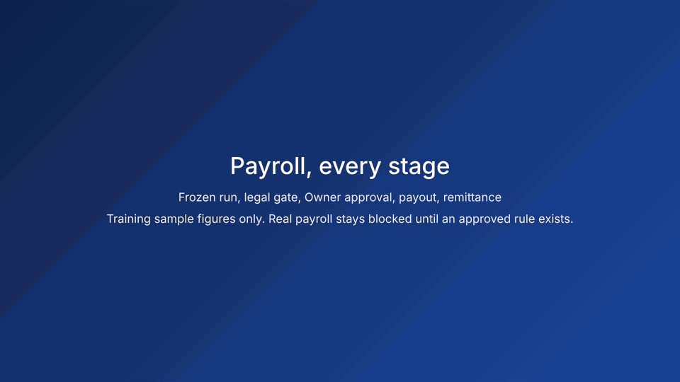

# HR and payroll, stage by stage

HR & Payroll is an Owner/Management area. Every step is saved as an auditable draft, and approval is a separate permission-checked action. Read [HR and payroll boundaries](14-hr-payroll.md) first: the HR lifecycle extension and statutory payroll rules must be approved before real payroll can run.


All screens and figures in the animations are **training sample data**. The 16.2.18 release ships **no default Ethiopian PAYE or pension rule schedule**. Never use a figure from an animation as a payroll rate.


## Watch: the nine HR lifecycle stages



### Employee master

New hires come only from an approved recruitment decision. Direct employee creation is disabled. A pending hire is activated after a signed contract, verified documents, completed onboarding and approved compensation.



### 1. Workforce planning

Create a manpower plan (headcount and budgets) and positions before opening a vacancy.



### 2. Recruitment and selection

Open an approved vacancy, record candidates, applications and interviews, then a documented human decision.



### 3. Contracts, documents and onboarding

Record contract and personnel-document references and the onboarding checklist. Private-document storage integration is a required production gate.



### 4. Shifts, attendance and leave

Approved schedule and time data feed payroll. Manual changes need a reason and are audited.



### 5. Compensation, increments, allowances and benefits

Components are effective-dated. Allowance splits use only an approved rule set; unknown categories are fully taxable by default.



### 6. Statutory rule register

Rules are source-backed and effective-dated. A draft rule is not active, and the person who drafted a rule cannot approve it.



### 7 to 9. History, changes and exit

Training, performance and employee changes stay effective-dated. Final settlement is calculated only against an Owner-approved rule and payroll rule version; approval, posting and payment are separate actions. The ERP Policy and SOP Library holds the 24 controlled procedures (draft, not approved).



## Watch: the payroll run, every stage

_The animation first shows the real default behaviour (Generate is blocked), then a training-only assumption that an approved rule bundle exists so you can see the later stages._



### Open section 10, Frozen payroll runs and legal gate

Owner or authorised payroll staff open HR & Payroll and expand section 10.



### Create the run draft

Enter the period (YYYY-MM), start and end dates, run kind (Normal, Approved adjustment or Controlled reversal) and a unique idempotency key of at least 12 characters. Select Create frozen-run draft. Nothing is calculated yet.



### Generate (the legal gate)

Select Generate. Without an independently reviewed, approved rule bundle for that exact pay period the ERP answers: _No independently reviewed rule bundle is approved for this exact pay period. Payroll is blocked._ Stop; do not work around it.



### Submit for Owner

Once a run is calculated, the preparer selects Submit for Owner and enters a preparation review note of at least 10 characters.



### Owner approve and post

The Owner independently verifies headcount, variances, rule source, gross, net and liabilities, then selects Owner approve + post with a review note of at least 20 characters. This is maker-checker: preparer and approver are different people.



### Instruct the payout batch

Choose BANK or CASH and enter the external bank batch or cash voucher reference. The ERP records the instruction; it does not move money.



### Record each recipient result

Section 11 lists each recipient. Mark every one PAID (with the transfer reference), FAILED or RETURNED (with a reason). A journal is not proof that an employee was paid.



### Reconcile the external total

Enter the bank statement or cash voucher reference and confirm the successful total equals the recorded recipient successes.



### Statutory remittances

Section 12 keeps PAYE, employee pension and employer pension obligations open until the official filing reference, payment reference and an approved private receipt are recorded and the amount reconciles.



Employee expense claims (section 13) and individual payees such as creators, freelancers and service providers (section 14) follow the same maker-checker pattern and stay in legal review until the correct rule and a qualified written opinion are approved.


**Known 16.2.18 defect to report.** In the pristine 16.2.18 front-end script the per-recipient **Result** buttons in section 11 do not respond, because the click handler exits when a button carries no record id. Until the maintainer fixes it, payout results cannot be recorded from the screen and batches cannot be reconciled. Confirm on the production site and report it with the batch reference. The animation shows the later stages as the intended outcome.

