# README

> **Engineering workspace:** product architecture, domain contracts, garment workflow, AI-assisted pattern/cutting design, acceptance specifications and a release-ready repository plan.\
> **Workspace state:** `PREPARED_AND_LOCALLY_CONTRACT_TESTED_NOT_PUSHED_NOT_RELEASED`.\
> **Prepared:** 15 November 2026; four-source contribution update: 17 November 2026.\
> **Canonical codebase:** `aistockland-web/Erp-version-16.1.89`, delivery branch base `fe937ea97123a243c410696e4007c48d3332803d`.

This folder is a commit-ready product-engineering work package for the existing Stockland ERP repository. It is not a replacement application, not a WordPress installer, and not permission to alter live data. It does not bring in external repositories' CSS, UI assets, application code, database dumps, secrets, or demo credentials. The four intended contributors are Euro Suits ERP, Production Quality ERP V2.0, Thread ERP and T-VERSE. BengalTex is a supplemental process cross-check. Their best practices are independently reimplemented; Stockland code remains the implementation source.

## Product objective

Evolve the existing Stockland ERP into a **configurable multi-company Apparel & Lifestyle Supply Chain SaaS** for:

* Apparel brands and design houses.
* Brands using outsourced garment factories.
* CMT and full-package garment manufacturers.
* Textile, fabric, trim and garment suppliers.
* Wholesalers, distributors and import/export operators.
* Retailers, store chains and eCommerce operators.
* Vertically integrated apparel groups.

The product connects the complete garment lifecycle from the initial design brief through fit/sample approval, sourcing, material planning, optional factory execution, quality, packing, warehouse, wholesale/retail fulfillment, returns, Finance settlement and traceability.

**Manufacturing is a selectable capability, not a mandatory product dependency.** Retailers, wholesalers, distributors and outsourced-manufacturing brands must work without owned-factory MRP, cutting, sewing MES/SFC or machine integration.

## Product applications and ownership

| Application                    | Owns                                                                                                                                                                                                                                       | Explicitly does not own                                        |
| ------------------------------ | ------------------------------------------------------------------------------------------------------------------------------------------------------------------------------------------------------------------------------------------ | -------------------------------------------------------------- |
| Apparel Supply Chain (primary) | Apparel product/style/variant extensions, design collaboration, PLM, patterns, samples, BOM/routing, demand, sourcing, MRP, optional factory execution, quality, WMS, packing, OMS, B2B, retail/POS adapters, fulfillment and traceability | Employee master, payroll calculation and GL journal posting    |
| HR & Workforce (independent)   | Person/employee master, employment, skills, shifts, attendance, leave, compensation, payroll, payslips, payments/remittance, statutory country packs, HR documents                                                                         | Stock, material issue, production order state, general ledger  |
| Finance (independent)          | COA, GL, AP, AR, tax, bank, FX, payments, budgets, assets, WIP/COGM and period close                                                                                                                                                       | Product Master, warehouse reservation and shop-floor execution |

HR and Finance are independent target applications. Their code is still co-loaded in the legacy Stockland WordPress plugin. Do not describe application independence as implemented until each has a separate deployable, data owner, identity/permission boundary, migration/version lifecycle, API/event contract, test suite and release process.

### Integration contract

Cross-application communication uses versioned authenticated APIs or durable events with at least `event_id`, `tenant_id`, `source_application`, `aggregate_type`, `aggregate_id`, `schema_version`, `occurred_at`, `correlation_id` and `idempotency_key`. Consumers deduplicate events; producers use a durable outbox or equivalent. No direct cross-application table writes.

* Apparel → Finance: approved PO, accepted GRN, shipment, invoice request, stock valuation change, production-cost finalization.
* Apparel → HR: approved skill/shift demand and accepted production-output references only when HR is connected and authorizes the data.
* HR → Apparel: minimal worker availability/skill eligibility references; no salary, payroll, identity documents or sensitive HR detail.
* Finance → Apparel: credit hold/payment status/credit availability through an explicit integration contract.

## Customer profiles and configurable capabilities

Each customer starts with blank legal/company details and builds its own organization. A profile activates capabilities but never forks the product codebase.

| Customer profile                  | Default capabilities                                                                                                 | Optional capabilities                                       |
| --------------------------------- | -------------------------------------------------------------------------------------------------------------------- | ----------------------------------------------------------- |
| Brand / design house              | Product Master, PLM, design, patterns, samples, costing, sourcing, buyer order, quality, wholesale/eCommerce         | Owned factory MRP/MES/SFC, retail stores                    |
| Outsourced brand                  | PLM, samples, costing, supplier/factory collaboration, external QC evidence, inbound FG, OMS                         | Owned-factory execution, internal material warehouse        |
| Contract/CMT factory              | Customer style/order intake, BOM responsibility, capacity, production orders, cutting, sewing, WIP, quality, packing | Customer-facing PLM, retail/POS                             |
| Full-package garment manufacturer | PLM, sourcing, MRP, factory capacity, MES/SFC, QAM/SQC, WMS, production costing                                      | Direct retail/eCommerce                                     |
| Wholesaler / distributor          | Product/variant, purchasing, warehouse, ATP, B2B, dispatch, returns                                                  | PLM, own factory, retail                                    |
| Retailer / chain                  | Product/variant, supplier procurement, replenishment, branch stock, POS, eCommerce, returns                          | PLM, manufacturing                                          |
| Vertically integrated group       | Brand + factory + distribution + wholesale + retail + eCommerce                                                      | Advanced AI planning, portals and additional legal entities |

Every capability gate applies to backend routes, services, scheduled/queued work, permissions, data access, reports, imports/exports and notifications—not only navigation visibility.

## Strict end-to-end garment workflow

```mermaid
flowchart TD
  A[New customer tenant and organization] --> B[Season / collection / design brief]
  B --> C[Concept sketch and technical flats]
  C --> D[Pattern drafting / block / grading]
  D --> E[Samples: proto / fit / size set / PP]
  E --> F{Technical and buyer approval?}
  F -- revise --> C
  F -- approved --> G[Approved tech pack / BOM / routing]
  G --> H[Enquiry / costing / quotation / buyer order]
  H --> I[Demand plan / capacity / MPS]
  I --> J[MRP and material/capacity exceptions]
  J --> K[PR / RFQ / PO / supplier collaboration]
  K --> L[Supplier dispatch / GRN / incoming QC]
  L --> M[Accepted raw material and roll/shade/bin]
  M --> N[Reservation / kitting / production release]
  N --> O[Relax / spread / lay / marker planning]
  O --> P[AI-assisted marker proposal / human approval]
  P --> Q[Cut tickets / panels / bundles]
  Q --> R[Sewing lines / operation scans / WIP]
  R --> S[Optional print / embroidery / wash / subcontract]
  S --> T[Inline / end-line quality / rework]
  T --> U[Finishing / pressing / trims]
  U --> V[Final inspection and quality release]
  V --> W[Packing / cartonization / SSCC]
  W --> X[Finished-goods warehouse]
  X --> Y[Allocate / pick / verify / dispatch]
  Y --> Z[Wholesale / retail / eCommerce delivery]
  Z --> AA[Finance settlement / returns / claims]
  AA --> AB[Traceability / reconciliation / BI]
```

The detailed rules and exceptions are in:

* `docs/INDUSTRIAL_ENGINEERING_AND_CAPACITY.md`
* `docs/ENGINEERING_GUARDRAILS.md`
* `docs/APPAREL_PRODUCT_LIFECYCLE.md`
* `docs/MODULE_CATALOG_AND_PROFILE_MATRIX.md`
* `docs/CURRENT_BASELINE_AND_GAPS.md`
* `docs/DESIGN_PATTERN_SAMPLE_WORKFLOW.md`
* `docs/CUTTING_MARKER_AI_ASSISTANT.md`
* `docs/PATTERN_GEOMETRY_AND_CAD_INTERCHANGE.md`
* `docs/AI_MODEL_EVALUATION.md`
* `docs/MES_SFC_QUALITY_WMS_OMS.md`
* `docs/DOMAIN_MODEL_AND_EVENTS.md`
* `docs/ACCEPTANCE_AND_REGRESSION_MATRIX.md`
* `docs/STANDARDS_AND_LOCALIZATION.md`
* `docs/API_AND_COMMAND_CONTRACTS.md`
* `docs/WORKFLOW_STATE_MACHINE_CATALOG.md`

## Design, pattern making and sample development

The design-to-pattern portion is a first-class product domain, not a product image upload form.



## Design brief

Customer/brand, season, collection, target market, intended use, price position, silhouette, fit block, material intent, visual direction, delivery date and approvals.



## Concept

Mood boards, reference images, hand sketches and concept illustrations. AI imagery can create concept drafts only; they are not production instructions.



## Technical flats

Controlled front/back/side views, style details, stitch/seam callouts, trims, labels, construction annotations and measurement-point references.



## Material development

Fabric construction/composition, weight/GSM, usable width, stretch/recovery, shrinkage, shade family, finish, care constraints, trim/label/packaging references, supplier and test/certificate links.



## Pattern drafting

Style block, component pieces, seam lines, cut lines, seam allowance, darts, notches, drill marks, fold lines, grainline, piece pairing/mirroring and quantity per garment.



## Grade rules

Point-of-measure (POM), base size, grading increments, size range, tolerance, grade nest and size-set sample evidence.



## Fit/sample

Prototype → fit → size set → pre-production; comments, fit photos, measurement deltas, pattern corrections, sign-off and version linkage.



## Tech pack release

Approved measurements, BOM, routing, patterns, grade nest, colourways, labels, care, packaging, quality plan and revision checksum are frozen together.




No buyer order or production order may refer to a mutable “latest” style spec. It pins the exact approved style, tech-pack, BOM, pattern, grade and routing revisions.


## Pattern and marker planning assistant

A pre-cut AI assistant is specified in `docs/CUTTING_MARKER_AI_ASSISTANT.md`.

It has three distinct layers:

* **Conversational assistant:** understand the planner's request, explain constraints, ask for missing fabric/roll/order/pattern details and summarize candidate plans.
* **Deterministic geometry/optimization engine:** validate pattern geometry, grade sets, grainline/orientation, roll width, selvage, defects, shade and order ratios; calculate placements, marker length, yield and waste; produce ranked feasible layouts.
* **Vector drawing/preview service:** render the validated candidate as an SVG/PDF preview and a versioned machine/CAD export only where a verified partner format adapter exists.


**The AI never directly changes the approved pattern, authorizes material issue, sends a cut command, starts a cutting machine or releases production.** Every marker is a proposal until the Pattern Master and Cutting Manager approve the exact input and output hashes. The ERP validates the solver output independently before release.


The product must provide a useful non-AI manual marker workflow and a rule-based explanation fallback when an AI provider or optimization service is unavailable. External model/optimizer calls are tenant-opt-in, scoped, auditable and versioned; they are not a hidden dependency for the existing Stockland shared-host runtime.

## Engineering approach and reuse policy

* Canonical codebase remains the existing Stockland WordPress/PHP ERP, with its current REST, authorization, DB gateway, workflow, audit, stock ledger, PWA and Bootstrap/CSS module architecture.
* The existing Codespaces `.devcontainer/` is reused unchanged: PHP 8.3, Node 22, Python 3.12, Composer, GitHub CLI, SHA-verified WP-CLI, private MariaDB 10.11 and optional MySQL 8.0.46 disposable WordPress profiles.
* New garment domains are additive and behind clear module boundaries. Do not create another Product Master, stock ledger, GL or payroll engine.
* No external repository CSS, UI component library, logo, images, or code is copied. The current Stockland design tokens, local Bootstrap 5.3.8 and ordered CSS source modules remain the only existing visual source of truth. This workspace makes no CSS changes.
* The four reference repositories inform domain behavior; all implementation code is written in Stockland's conventions and separately reviewed.
* Exact commits, package manifests and SHA-256 hashes prove identity/integrity. They do not prove licence rights, code correctness, security, QA, certification or live readiness.

## Protected Stockland invariants

1. Preserve the 49 operational schema keys: 29 Core/Operations + 16 Finance/Procurement + four legacy HR/Payroll.
2. The separate 37-table HR lifecycle extension is Owner-approved and fingerprint-controlled; it is not automatic DDL. 33 HRX recognized keys are preservation-only.
3. Preserve all existing Stockland customer/company, Central Warehouse, branch, Product Master STYLE/VARIANT, SKU, stock ledger, reservation, POS, procurement, posted Finance, HR/payroll, private-vault, SOP and audit history.
4. The current Stockland tenant remains one configured company. Multi-company SaaS provisioning and tenant isolation are not claimed implemented.
5. HR/Finance remain co-loaded in the legacy plugin until separately deployable applications are actually extracted.
6. No production database, real employee, payroll, payment, Finance posting, live deployment, DNS, SSL or hosting changes occur in this workspace.
7. No Ethiopian statutory rule is invented. Statutory payroll stays fail-closed until exact official effective-dated sources, qualified local review and Owner approvals exist.

## Source baseline and current GitHub state

| Item                                       | Exact state                                                                                                                                                                                                                                     |
| ------------------------------------------ | ----------------------------------------------------------------------------------------------------------------------------------------------------------------------------------------------------------------------------------------------- |
| Canonical repository                       | `aistockland-web/Erp-version-16.1.89`                                                                                                                                                                                                           |
| Working delivery branch                    | `delivery/stockland-full-erp-completion-2026-11-11`                                                                                                                                                                                             |
| Latest merged base used for this workspace | `fe937ea97123a243c410696e4007c48d3332803d` (merge PR #133)                                                                                                                                                                                      |
| Base tree                                  | `f89615a764cc3ce391380bf31b9d75b7b9e55357`                                                                                                                                                                                                      |
| PR #133                                    | Merged at `fe937ea…`; 247 synthetic payroll assertions across the four PHP/database matrix combinations; no real Ethiopian statutory rules approved                                                                                             |
| PR #134                                    | Open, unmerged; accessibility/CSS contrast and accessible notification label changes; not included in this workspace; keep its workstream separate                                                                                              |
| GitHub connection                          | Canonical repository is read-only (`push:false`); no repository-create action is exposed                                                                                                                                                        |
| Uploaded installer                         | `STOCKLAND_ERP_16.2.18_MASTER_WORDPRESS_INSTALLER (8).zip`, SHA-256 `aee5c551bd3367717091de066bfd5f86d8298dda1f6361d7534813d8087cd54e`; its manifest does not identify a canonical Git commit, so it is not the source parent for these changes |


Do not start from the old 14 November PLM review zip or assume it includes the PR #133 merge. The canonical delivery branch is authoritative for the next implementation. Reconcile PR #134 before opening an apparel PR; do not overwrite or cherry-pick its UI changes blindly.


### Exact 16.2.18 installer used for the new local code overlay

The Euro Suits PLM source overlay was applied to a disposable extraction of the canonical CI-built 16.2.18 installer from merged PR #133, not to the separately uploaded `(8).zip` whose manifest lacks the source commit.

* Source commit: `fe937ea97123a243c410696e4007c48d3332803d`
* Exact installer: `STOCKLAND_ERP_16.2.18_MASTER_WORDPRESS_INSTALLER_fe937.zip`
* SHA-256: `4a6bb09b4f5819873fff7f1417de20494c7d791003faf9a55649458458977021`
* Code-only overlay: `implementation/patches/16.2.18-eurosuits-plm-code-only.patch`


The overlay is a source patch only. The current plugin release identity, `RELEASE_MANIFEST.json`, `README.md` and `GO_LIVE_RUNBOOK.md` are not revised by the patch because those exact documentation hunks conflict with the 16.2.18 versions. Do not package or install this overlay as a release.


## Local workspace structure

* `contracts/schemas/` — 25 proposed JSON Schema 2020-12 contracts for design, measurement, pattern/grade, tech pack, samples, material roll/lot, BOM, lay/marker, cut bundle, production order, operation events, quality/CAPA, packing/carton, subcontract and cross-app events.
* `codespaces/README.md` — reuses the existing root Codespaces profile; no new environment is created.
* `commit-plan/` — proposed commit series and PR template; no remote commits exist.
* `qa/` — QA-only JSON Schema validation harness and `NOT_RUN.md` state receipt.
* `release/` — SHA-256 manifest and review-only release state. It is not a plugin ZIP.

## Workspace status

| Area                                                                                        | Status                                                                                                                                      |
| ------------------------------------------------------------------------------------------- | ------------------------------------------------------------------------------------------------------------------------------------------- |
| Four repository research and evidence map (Euro Suits, Production Quality, Thread, T-VERSE) | Prepared and corrected                                                                                                                      |
| Target end-to-end garment workflow                                                          | Prepared                                                                                                                                    |
| Design/pattern/sample lifecycle                                                             | Prepared                                                                                                                                    |
| AI pattern/marker safety and API contract                                                   | Prepared                                                                                                                                    |
| Domain/data/event contracts                                                                 | 30 JSON Schemas prepared; representative payload tests pass                                                                                 |
| Codespaces reuse instructions                                                               | Prepared; existing container config not modified                                                                                            |
| PHP runtime integration                                                                     | Euro Suits PLM first-slice patch prepared and contract-tested against a disposable exact 16.2.18 copy; not integrated into canonical source |
| Database schema migration                                                                   | Not started                                                                                                                                 |
| CSS/UI changes                                                                              | None                                                                                                                                        |
| JSON Schema and representative payload tests                                                | 10 static tests pass                                                                                                                        |
| Euro Suits PLM/module code slice                                                            | Local disposable source overlay: 88 + 39 contract checks pass; 87 PHP lints pass                                                            |
| Production Quality MES, Thread scan/gate and T-VERSE channel-order PHP runtime              | Not implemented yet                                                                                                                         |
| Application/E2E tests                                                                       | Not run; no WordPress/DB/browser runtime started                                                                                            |
| GitHub repository creation                                                                  | Blocked: no create-repository tool and canonical repo permission is read-only                                                               |
| Remote branch/commits/PR/release                                                            | Not created; no remote write authority                                                                                                      |
| Production deployment                                                                       | Not performed                                                                                                                               |

## Read order

1. `docs/REFERENCE_REPOSITORIES_AND_ADOPTION.md`
2. `docs/ENTERPRISE_ARCHITECTURE.md`
3. `docs/CURRENT_BASELINE_AND_GAPS.md`
4. `docs/MODULE_CATALOG_AND_PROFILE_MATRIX.md`
5. `docs/APPAREL_PRODUCT_LIFECYCLE.md`
6. `docs/DESIGN_PATTERN_SAMPLE_WORKFLOW.md`
7. `docs/PATTERN_GEOMETRY_AND_CAD_INTERCHANGE.md`
8. `docs/INDUSTRIAL_ENGINEERING_AND_CAPACITY.md`
9. `docs/CUTTING_MARKER_AI_ASSISTANT.md`
10. `docs/AI_MODEL_EVALUATION.md`
11. `docs/MES_SFC_QUALITY_WMS_OMS.md`
12. `docs/WORKFLOW_STATE_MACHINE_CATALOG.md`
13. `docs/DOMAIN_MODEL_AND_EVENTS.md`
14. `docs/API_AND_COMMAND_CONTRACTS.md`
15. `docs/SECURITY_TENANCY_AND_DATA_GOVERNANCE.md`
16. `docs/STANDARDS_AND_LOCALIZATION.md`
17. `docs/ENGINEERING_GUARDRAILS.md`
18. `docs/ACCEPTANCE_AND_REGRESSION_MATRIX.md`
19. `contracts/README.md`
20. `docs/CODESPACES_AND_RELEASE_HANDOFF.md`
21. `docs/COMMIT_RELEASE_PLAN.md`

The workspace contains a local Euro Suits PLM code-only patch and four-source domain contracts. It is ready for source review and staged feature-branch integration after canonical write access is granted. It is not a deployable ERP package.
